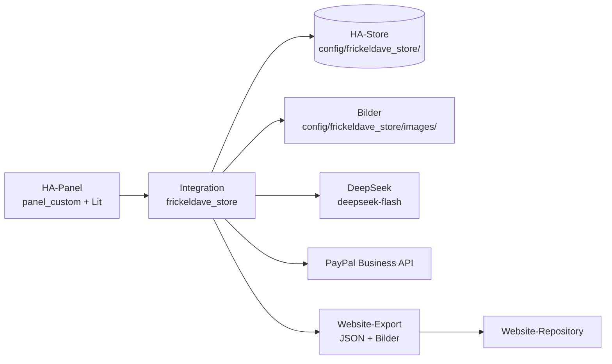

# FR008: Verwaltung der Handmade-Produkte in Home Assistant

Dieses Dokument beschreibt das geplante Verwaltungswerkzeug für den Handmade-Katalog. Die bisherige
Verwaltung außerhalb von Home Assistant und die separate Pflege von `public/data/handmade.json` samt
Bildern im Website-Repository werden durch eine Custom Integration ersetzt. Produktdaten und Bilder
liegen danach in Home Assistant; die Website veröffentlicht den Katalog aus deren Export.

- Issue: [#289](https://github.com/Frickeldave/frickeldave.github.io/issues/289)
- Integrations-Repository: <https://github.com/Frickeldave/frickeldave.home.net>
- Website-Katalog: [FR003 - Handmade Produktcatalog](../old/features/fr003-catalog.md)
- Status: geplant; dieses Dokument beschreibt den Stand der Spezifikation, keine umgesetzte
  Funktion.

> Hinweis zur Repository-Bezeichnung: Die Spezifikation in #289 nennt
> `Frickeldave/frickeldave-store`. Am 27.10.2026 hat David Koenig entschieden, dass die Integration
> im Repository `Frickeldave/frickeldave.home.net` liegt. Dieses Dokument verwendet durchgehend den
> neuen Namen. Die Integrations-Domain bleibt `frickeldave_store`.

## Zweck und Umfang

Das Werkzeug führt die bisher getrennten Arbeitsabläufe in einer deutschen Oberfläche innerhalb von
Home Assistant zusammen:

- Produkte, Bilder, Tags, Sichtbarkeit und Bestände pflegen.
- Bestände als Buchungen nachvollziehen.
- Beschreibungen per KI vorschlagen lassen und erst nach bewusster Übernahme speichern.
- Kunden und – nach bestätigtem Schnittstellenumfang – PayPal-Artikel und -Kunden verwalten.
- Den Katalog für die Website exportieren.

Der Betrieb muss auf Home Assistant Container funktionieren: ohne Supervisor, ohne Add-on und ohne
zusätzlichen Anwendungscontainer. Die Integration ist damit eine normale Custom Integration, die
ausschließlich über HACS verteilt und über die Home-Assistant-Oberfläche eingerichtet wird.

## Architektur

### Integration und Verteilung

- Ein Repository, eine Domain, genau ein Integrationsverzeichnis:
  `custom_components/frickeldave_store/`.
- Verteilung als benutzerdefiniertes HACS-Repository vom Typ Integration. `hacs.json` führt Name und
  Mindestversion von Home Assistant; `manifest.json` führt `domain`, `name`, `version`,
  `documentation`, `issue_tracker` und `codeowners`.
- Versionierung nach SemVer; der Git-Tag entspricht der Manifest-Version ohne führendes `v`.
- Keine Supervisor- oder Add-on-Abhängigkeit: im Integrationscode kommen keine `hassio`- oder
  Supervisor-Aufrufe vor.

### Oberfläche

- Das Panel wird als `panel_custom`-Web-Component mit Lit registriert, `embed_iframe=False`.
  Statische Assets werden über `async_register_static_paths` ausgeliefert.
- Kein Tailwind. Das Panel nutzt die HA-Design-Tokens (`--primary-color`, `--card-background-color`,
  `--primary-text-color`, `--secondary-text-color`, `--error-color`) und eine eigene
  `--fd-*`-Schicht im Shadow DOM. Daraus folgen Light/Dark und HA-Themes ohne eigene Umschaltung.
- Die Sprache der Oberfläche ist Deutsch.
- `require_admin` ist keine Zugangskontrolle, sondern steuert nur die Sichtbarkeit des Panels. Jede
  geschützte Route prüft die Berechtigung serverseitig (siehe [Berechtigungen](#berechtigungen)).

### Navigation

- Das Panel trägt oben eine Leiste im Stil von Home Assistant. Eine Tab-Leiste, die zwischen
  Produkten und Einstellungen wechselt, gibt es nicht mehr.
- Das Hamburger-Symbol links öffnet die Home-Assistant-Seitenleiste.
- Das Drei-Punkte-Menü rechts führt zwei Einträge:
  - **KI**: Dialog für die Einstellungen des KI-Anbieters, sichtbar nur für die Rolle
    Anwendungsverwaltung.
  - **Tags verwalten**: Pflege der Tags, sichtbar für die Rolle Produktpflege.
- Einstellungen und Tag-Verwaltung liegen damit außerhalb der Hauptfläche. Die Hauptfläche bleibt
  der Produktliste und ihren Filtern vorbehalten.

### Datenhaltung

| Inhalt        | Ablage                                                                   |
| ------------- | ------------------------------------------------------------------------ |
| Metadaten     | HA-`Store` (JSON, atomar, versioniert) unter `config/frickeldave_store/` |
| Produktbilder | Dateien unter `config/frickeldave_store/images/<artikelnummer>/`         |

Bilder gehören bewusst nicht in `.storage`, nicht nach `/media` und nicht nach `/share`. Beide
Ablagen liegen unter `config/` und sind damit in den Backups des HA-Containers enthalten.

Datei-, Bild- und Netzwerkoperationen laufen nicht blockierend (Executor beziehungsweise `aiohttp`
mit Timeouts). Fehler externer Dienste werden abgefangen und dürfen Home Assistant nicht
beeinträchtigen.

### Migrationen

Schema-Änderungen laufen über `config_flow.VERSION`/`MINOR_VERSION` und `async_migrate_entry`.
Zusätzlich trägt jeder Datensatz eine Schema-Version. Migrationen sind idempotent und legen vor dem
Lauf einen Snapshot an.

## Installation

1. Home Assistant Container mit laufender Oberfläche und installiertem HACS vorbereiten.
2. In HACS ein benutzerdefiniertes Repository anlegen: Repository-URL
   `https://github.com/Frickeldave/frickeldave.home.net`, Typ **Integration**.
3. Die Integration `frickeldave_store` installieren.
4. Home Assistant neu starten. Erst danach lädt die Custom Integration.
5. Die Integration über **Einstellungen → Geräte & Dienste → Integration hinzufügen** einrichten
   (siehe [Einrichtung und Optionen](#einrichtung-und-optionen)).
6. Das Panel erscheint anschließend in der HA-Seitenleiste.

Updates laufen über HACS: Ein neuer Git-Tag entspricht einer neuen Manifest-Version, HACS bietet das
Update an, nach der Installation ist ein Neustart von Home Assistant erforderlich. Ein Update
überlebt den Neustart, weil Daten und Bilder unter `config/` liegen und nicht im
Integrationsverzeichnis.

Die Aufnahme in den offiziellen HACS-Katalog ist nicht Teil der ersten Version; ein
benutzerdefiniertes Repository genügt.

## Einrichtung und Optionen

Einrichtung und Optionen erfolgen ausschließlich über Config Flow und Options Flow. Eine
YAML-Konfiguration gibt es nicht.

- Der Config Flow legt die Integration an und registriert das Panel.
- Der Options Flow pflegt die Einstellungen, insbesondere die Zugangsdaten und das Modell des
  KI-Anbieters.
- Zugangsdaten bleiben serverseitig und erscheinen nicht in Logs, Diagnose oder Export.
- Jede Option der Konfigurationsdokumentation entspricht genau einem Feld der Oberfläche. Die
  abschließende Feldliste wird mit der Architektur festgelegt; dieses Dokument führt keine
  erfundenen Felder.

## Datenmodell (Schema-Version 1)

Ein Produkt besteht aus:

| Feld            | Typ                | Bedeutung                                                            |
| --------------- | ------------------ | -------------------------------------------------------------------- |
| `articleNumber` | string (6 Zeichen) | Kategoriepräfix plus Zufallszeichen, Primärschlüssel, unveränderlich |
| `name`          | string             | Produktname                                                          |
| `description`   | string             | Beschreibung                                                         |
| `category`      | Code               | `3D`, `EP`, `LA`, `SB` oder `WO`, genau eine je Produkt              |
| `price`         | Dezimal            | Preis in Euro                                                        |
| `size`          | string             | Größenangabe                                                         |
| `tags`          | string[]           | frei wählbare Tags, öffentliche Filter                               |
| `customizable`  | boolean            | Personalisierbar (Auftragsproduktion)                                |
| `visible`       | boolean            | Sichtbarkeit auf der Website                                         |
| `stock`         | integer ≥ 0        | Lagerbestand                                                         |
| `salesCabinet`  | integer ≥ 0        | Bestand im Verkaufsschrank                                           |
| `images`        | Liste              | maximal zehn Bilder, geordnet, genau ein Hauptbild                   |
| `archived`      | boolean            | Soft-Delete                                                          |
| `createdAt`     | Zeitstempel        | Anlage                                                               |
| `updatedAt`     | Zeitstempel        | letzte Änderung                                                      |
| `schemaVersion` | integer            | Schema-Version des Datensatzes, aktuell `1`                          |

Regeln:

- `articleNumber` ist sechs Zeichen lang, beginnt mit dem Kategoriepräfix und bleibt nach dem
  Anlegen unverändert. Die Eindeutigkeit wird beim Anlegen geprüft, auch bei paralleler Erstellung.
- Ein Kategoriewechsel nach dem Anlegen ist nicht möglich. Stattdessen wird ein neues Produkt
  angelegt.
- Löschen gibt es nur als Soft-Delete über `archived`. Ein Hard-Delete-Pfad existiert nicht.
- Importquelle ist der bestehende Live-Katalog `public/data/handmade.json` mit 63 Produkten und fünf
  Kategorien samt Bildordnern.
- Die Felder `stock` und `salesCabinet` existieren im Live-Katalog bereits, werden von der Website
  aber noch nicht ausgewertet; siehe [FR003](../old/features/fr003-catalog.md).

### Kategorien

| Code | Kategorie  | Bedeutung              |
| ---- | ---------- | ---------------------- |
| `3D` | 3D-Druck   | 3D-gedruckte Produkte  |
| `EP` | Epoxidharz | Epoxidharz-Produkte    |
| `LA` | Laser      | lasergeschnittene Ware |
| `SB` | Steinmasse | Steinmasse-Produkte    |
| `WO` | Holz       | Holzprodukte           |

### Suche, Filter und Sortierung

- Suche über Name, Beschreibung, Artikelnummer und Tags.
- Filter: Kategorie, Tags, personalisierbar, auf Lager, im Schrank, sichtbar, unsichtbar.
- Verknüpfung: Kategorie ODER, Tags ODER, alle übrigen Filter UND.
- Auf breiten Desktop-Monitoren stehen Kategorien und Tags nebeneinander; erklärende Hilfssätze
  entfallen.
- Sortierung nach Name und Preis, jeweils auf- und absteigend; die Sortierung bleibt bei
  Filteränderungen erhalten.
- Bildverwaltung: maximal zehn Bilder je Produkt, Reihenfolge und genau ein Hauptbild. Ein elfter
  Upload wird mit Meldung abgelehnt, ohne Teilpersistenz.

## Bestandsmodell

`stock` (Lager) und `salesCabinet` (Verkaufsschrank) sind getrennte Bestände und getrennt filterbar:
„Auf Lager“ bedeutet `stock > 0`, „Im Schrank“ bedeutet `salesCabinet > 0`.

- Bestandsänderungen werden als Buchungen erfasst: Zugang, Abgang, Umlagerung, Korrektur.
- Jede Buchung trägt einen Zeitstempel und den auslösenden HA-Benutzer.
- Einzelstücke sind Produkte mit Menge 1.
- Personalisierbare Produkte sind Auftragsproduktion; Verkäufe buchen sie nicht automatisch ab.
- Eine Umlagerung ist eine Buchung zwischen `stock` und `salesCabinet`, keine direkte Feldänderung.

## Website-Export

Die Integration ist führend, die Website konsumiert den Export.

- Der Export enthält ein JSON im bestehenden Schema von `public/data/handmade.json`, inklusive
  `stock` und `salesCabinet`.
- Exportiert werden ausschließlich nicht archivierte Produkte. `archived` und `visible` werden
  korrekt abgebildet.
- Die Artikelnummer bleibt der Schlüssel; wiederholte Exporte sind idempotent.
- Bilder werden als Dateien mitgeliefert und im Website-Repository unter
  `src/assets/handmade/<kategorie>/<artikelnummer>/` nach dem bestehenden Muster
  `<artikelnummer>-NN.jpg` abgelegt. Das erste Bild in Sortierreihenfolge ist das Hauptbild.

Der Transport des Exports zur Website ist noch offen (siehe [Offene Fragen](#offene-fragen)).

## KI-Beschreibungsvorschläge

- Der Anbieter ist konfigurierbar: API-Endpunkt, Modell, Zugangsdaten und Prompt.
- Initial kommt DeepSeek mit dem Modell `deepseek-flash` zum Einsatz. Das Modell akzeptiert Bilder
  (JPEG, PNG, GIF, WebP; Base64, externe URL oder Files API) mit maximal 1024 Tokens je Bild;
  verifiziert unter <https://api-docs.deepseek.com/guides/vision/>.
- Der initiale Prompt lautet: „Generiere mir eine schöne Beschreibung des Artikels für meinen
  Handmade-Shop.“
- Eingabe sind Produktbilder und bekannte Produktdaten.
- Das Ergebnis ist ein Vorschlag: editierbar und wird erst nach bewusster Übernahme gespeichert.
  Bestehende Beschreibungen werden nie automatisch überschrieben; „Verwerfen“ lässt sie unverändert.
- Fehler, Timeouts und Nutzungslimits werden verständlich angezeigt und verändern den gespeicherten
  Datenstand nicht.
- Es werden keine personenbezogenen Daten und keine Kunden- oder Finanzdaten in Prompt, Dateinamen
  oder Metadaten übergeben. EXIF- und GPS-Daten werden vor der Übertragung entfernt.
- Produktbilder werden an DeepSeek übertragen (Drittlandtransfer). Das ist in den
  Datenschutzhinweisen zu benennen.
- Zugangsdaten bleiben serverseitig und erscheinen nie in Logs, Diagnose oder Export.

## Berechtigungen

- Initial sind genau zwei HA-Benutzer freigegeben: David Koenig und Sandra Koenig, zugeordnet über
  die stabile HA-Benutzer-ID.
- Rollen sind kombinierbar. Finanzrechte folgen nie implizit aus Produktpflege oder
  Anwendungsverwaltung.

| Rolle                | Umfang                                                       |
| -------------------- | ------------------------------------------------------------ |
| Produktpflege        | Produkte, Bilder, Tags, Bestände, Sichtbarkeit, Archivierung |
| Finanzen             | spätere Finanzfunktionen                                     |
| Anwendungsverwaltung | Einstellungen und Benutzerfreigaben                          |

- Neue Funktionsbereiche sind standardmäßig gesperrt (Default Deny). Unbekannte Benutzer erhalten
  auf jeder geschützten Route `403` ohne Dateninhalt.
- Die Autorisierung erfolgt serverseitig bei jedem geschützten Zugriff, auch über APIs, Dateien,
  Exporte und WebSocket. Ein Rechteentzug greift beim nächsten geschützten Zugriff, auch bei bereits
  geöffnetem Panel.
- Nicht autorisierte Daten erscheinen nicht in HA-Entities, Attributen, Events, Logs, Diagnose-Dumps
  oder Exporten.
- Öffentliche Verkaufspreise bleiben von internen Finanzdaten (Einkaufskosten, Margen,
  Steuerrücklagen) getrennt.
- Die Zuordnung der Kundenverwaltung zu einer Rolle ist Teil der Rechte-Matrix aus der
  Architekturphase.

## Backup und Wiederherstellung

- Backups des HA-Containers umfassen `config/` inklusive `.storage` und `config/www`.
- Produktdaten und Bilder liegen bewusst unter `config/` und sind damit ohne Zusatzschritt im Backup
  enthalten.
- Die Wiederherstellung wird im Integrations-Repository als Runbook dokumentiert und einmal real
  getestet: identische Checksummen und erhaltener Migrationsstand.
- Ein Backup ersetzt keine Rechteprüfung: Personen mit Zugriff auf HA-Dateien oder Backups können
  die anwendungsinternen Sperren umgehen.

## Nicht Teil dieses Vorhabens

- Angebote, Rechnungen, E-Rechnungen, Ausgaben, Belegverwaltung und Mailversand aus dem
  Buchhaltungswerkzeug von Serkan. Eine Wiederverwendung ist ausgeschlossen.
- Steuerrücklagen und weitere Finanzfunktionen; sie sind spätere Erweiterungen, für die der
  Zugriffsschutz jetzt vorbereitet wird.
- Vollständig frei konfigurierbare Rollenverwaltung in der ersten Version.
- Aufnahme in den offiziellen HACS-Katalog.
- Schutz vor Personen mit administrativem Zugriff auf die HA-Laufzeit, Dateien oder Backups.
- Artikel-Löschung in PayPal; die Catalog-Products-API bietet dafür keinen Endpunkt. Artikel werden
  lokal archiviert.
- Änderungen an Blog, Rezepten oder sonstigen Website-Bereichen ohne Bezug zur Kataloganbindung.

## Offene Fragen

| Frage                                                                                         | Stand                                                                                        |
| --------------------------------------------------------------------------------------------- | -------------------------------------------------------------------------------------------- |
| Wie wird der Export zur Website transportiert (HTTPS-Pull aus HA oder PR aus einem Workflow)? | offen, Eigentümer Bruce, Entscheidung in der Architekturphase                                |
| Welchen Umfang bietet die PayPal-API für Kunden des Business-Kontos?                          | offen, Eigentümer David Koenig und Bruce, Test mit dem Konto                                 |
| Wie wirken Artikeländerungen auf bereits erstellte PayPal-Rechnungen?                         | offen, Eigentümer David Koenig                                                               |
| Welche Aufbewahrungs- und Löschfrist gilt für Kundendaten?                                    | offen, Vorschlag 24 Monate nach der letzten Bestellung, Eigentümer David Koenig und Jennifer |
| Welche stabilen HA-Benutzer-IDs gehören zu David und Sandra Koenig?                           | offen, wird bei der Umsetzung aus Home Assistant ermittelt                                   |

## Siehe auch

- [FR003 - Handmade Produktcatalog](../old/features/fr003-catalog.md)
- [Issue #289](https://github.com/Frickeldave/frickeldave.github.io/issues/289)
- [Integrations-Repository](https://github.com/Frickeldave/frickeldave.home.net)
- DeepSeek Vision: <https://api-docs.deepseek.com/guides/vision/>
- PayPal Catalog Products: <https://developer.paypal.com/docs/api/catalog-products/v1/>
