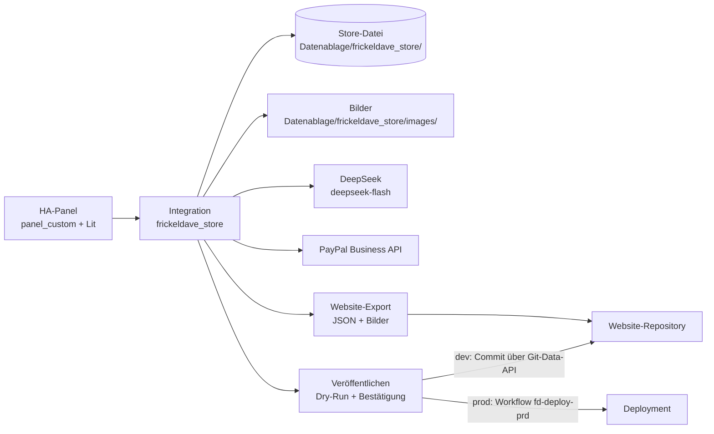

# FR008: Verwaltung der Handmade-Produkte in Home Assistant

Dieses Dokument beschreibt das Verwaltungswerkzeug für den Handmade-Katalog. Die bisherige Verwaltung
außerhalb von Home Assistant und die separate Pflege von `public/data/handmade.json` samt Bildern im
Website-Repository sind durch eine Custom Integration ersetzt. Produktdaten und Bilder liegen in
Home Assistant; die Website veröffentlicht den Katalog aus deren Export.

- Issue: [#289](https://github.com/Frickeldave/frickeldave.github.io/issues/289)
- Integrations-Repository: <https://github.com/Frickeldave/frickeldave.home.net>
- Website-Katalog: [FR003 - Handmade Produktcatalog](../old/features/fr003-catalog.md)
- Status: umgesetzt in Version 0.1.14 (Backend und Oberfläche, Stand 02.11.2026); Finanz- und
  Kundenfunktionen bleiben geplant.

> Hinweis zur Repository-Bezeichnung: Die Spezifikation in #289 nennt
> `Frickeldave/frickeldave-store`. Am 27.10.2026 hat David Koenig entschieden, dass die Integration
> im Repository `Frickeldave/frickeldave.home.net` liegt. Dieses Dokument verwendet durchgehend den
> neuen Namen. Die Integrations-Domain bleibt `frickeldave_store`.

## Zweck und Umfang

Das Werkzeug führt die bisher getrennten Arbeitsabläufe in einer deutschen Oberfläche innerhalb von
Home Assistant zusammen:

- Produkte, Bilder, Tags, Sichtbarkeit und Bestände je Lagerstätte pflegen.
- Bestände als Buchungen nachvollziehen.
- Beschreibungen per KI vorschlagen lassen und erst nach bewusster Übernahme speichern.
- Kunden und – nach bestätigtem Schnittstellenumfang – PayPal-Artikel und -Kunden verwalten.
- Den Katalog für die Website exportieren und nach `dev` beziehungsweise `prod` veröffentlichen.

Der Betrieb muss auf Home Assistant Container funktionieren: ohne Supervisor, ohne Add-on und ohne
zusätzlichen Anwendungscontainer. Die Integration ist damit eine normale Custom Integration, die
ausschließlich über HACS verteilt und über die Home-Assistant-Oberfläche eingerichtet wird.

## Architektur

### Integration und Verteilung

- Ein Repository, eine Domain, genau ein Integrationsverzeichnis:
  `custom_components/frickeldave_store/`.
- Verteilung als benutzerdefiniertes HACS-Repository vom Typ Integration. `hacs.json` führt Name und
  Mindestversion von Home Assistant; `manifest.json` führt `domain`, `name`, `version`,
  `documentation`, `issue_tracker` und `codeowners`.
- Versionierung nach SemVer; der Git-Tag entspricht der Manifest-Version ohne führendes `v`.
- Keine Supervisor- oder Add-on-Abhängigkeit: im Integrationscode kommen keine `hassio`- oder
  Supervisor-Aufrufe vor.

### Oberfläche

- Das Panel wird als `panel_custom`-Web-Component mit Lit registriert, `embed_iframe=False`.
  Statische Assets werden über `async_register_static_paths` ausgeliefert.
- Kein Tailwind. Das Panel nutzt die HA-Design-Tokens (`--primary-color`, `--card-background-color`,
  `--primary-text-color`, `--secondary-text-color`, `--error-color`) und eine eigene
  `--fd-*`-Schicht im Shadow DOM. Daraus folgen Light/Dark und HA-Themes ohne eigene Umschaltung.
- Die Sprache der Oberfläche ist Deutsch.
- Panel und Konfigurationspanel laden ihre Module unter einer URL mit Versionsparameter
  (`?v=<Version>`); die Hilfsfunktion `module_url()` in `const.py` erzeugt ihn für
  `PANEL_MODULE_URL` und `CONFIG_PANEL_MODULE_URL`. Ein eigener Frontend-View liefert die Dateien
  zusätzlich mit `Cache-Control: no-cache, must-revalidate`. Beides verhindert, dass nach einem
  Update alte Module im Browser-Cache liegen (siehe
  [Aktualisierung und Browser-Cache](#aktualisierung-und-browser-cache)).
- Panel und Konfigurationspanel zeigen die geladene Version an; dieselbe Information liefert die
  API: `GET /api/frickeldave_store/me` gibt `version`, `storage_schema_version` und
  `panel_module_url` zurück, `GET /api/frickeldave_store/settings` und
  `PATCH /api/frickeldave_store/settings` geben `version` zurück.
- `require_admin` ist keine Zugangskontrolle, sondern steuert nur die Sichtbarkeit des Panels. Jede
  geschützte Route prüft die Berechtigung serverseitig (siehe [Berechtigungen](#berechtigungen)).

### Navigation

- Das Panel trägt oben eine Leiste im Stil von Home Assistant. Eine Tab-Leiste, die zwischen
  Produkten und Einstellungen wechselt, gibt es nicht mehr.
- Das Hamburger-Symbol links öffnet die Home-Assistant-Seitenleiste.
- Das Drei-Punkte-Menü rechts führt den Eintrag **Tags verwalten** (Pflege der Tags, sichtbar für
  die Rolle Produktpflege) und zeigt darunter die geladene Version, etwa `v0.1.14`. Die Version
  bestätigt, welcher Build tatsächlich läuft.
- Die Einstellungen der Integration liegen nicht im Panel, sondern in der Integrationsseite von Home
  Assistant: **Einstellungen → Geräte & Dienste → Frickeldave Store → Zahnrad** öffnet das
  Konfigurationspanel (siehe [Einrichtung und Optionen](#einrichtung-und-optionen)). Damit gibt es
  im Panel keinen Eintrag **KI** mehr.
- Einstellungen und Tag-Verwaltung liegen damit außerhalb der Hauptfläche. Die Hauptfläche bleibt
  der Produktliste und ihren Filtern vorbehalten.

### Datenhaltung

Standardmäßig liegen die Daten unter `config/frickeldave_store/` und damit im Backup. Die Auswahl des
Speicherorts im Tab [Allgemeine Einstellungen](#tab-allgemeine-einstellungen) verschiebt Store-Datei,
Bilder und Snapshots nach `/share/frickeldave_store/` oder `/media/frickeldave_store/`. Ob der
Katalog im Backup steckt, ist aus dieser Auswahl abgeleitet und nicht getrennt einstellbar.

| Zustand                         | Ablage                      | Backup-Verhalten                                                                         |
| ------------------------------- | --------------------------- | ---------------------------------------------------------------------------------------- |
| Speicherort `config` (Standard) | `config/frickeldave_store/` | enthalten, weil das HA-Backup das gesamte `config/`-Verzeichnis sichert                  |
| Speicherort `share`             | `/share/frickeldave_store/` | nur enthalten, wenn `share` in einem Teil-Backup ausgewählt oder vom Host gesichert wird |
| Speicherort `media`             | `/media/frickeldave_store/` | nur enthalten, wenn `media` in einem Teil-Backup ausgewählt oder vom Host gesichert wird |

| Inhalt        | Ablage unterhalb des gewählten Speicherorts          |
| ------------- | ---------------------------------------------------- |
| Metadaten     | `frickeldave_store.data` (JSON, atomar, versioniert) |
| Produktbilder | `images/<artikelnummer>/`                            |
| Snapshots     | `backups/<zeitstempel>-<anlass>.json`                |

Bilder gehören bewusst nicht in `.storage`. Beim Speicherort `config` liegen Daten und Bilder unter
`config/` und sind damit ohne Zusatzschritt im Backup enthalten. Mit dem Speicherort `share` oder
`media` lassen sie sich aus dem Backup heraushalten: Das eingebaute HA-Backup sichert `config/`
vollständig und bietet keine Ausnahme für einzelne Unterordner; `share` und `media` sind nur
enthalten, wenn der Ordner in einem Teil-Backup ausgewählt oder vom Host gesichert wird. Wer Home
Assistant Container betreibt, muss das gewählte Volume selbst in den Container einhängen.

Datei-, Bild- und Netzwerkoperationen laufen nicht blockierend (Executor beziehungsweise `aiohttp`
mit Timeouts). Fehler externer Dienste werden abgefangen und dürfen Home Assistant nicht
beeinträchtigen.

### Persistenz und Datenverlust (bis 0.1.10)

Seit 0.1.11 liest und schreibt die Persistenzschicht die Store-Datei selbst: atomar, im gleichen
Envelope-Format (`version`, `minor_version`, `key`, `data`) wie zuvor und ohne Abhängigkeit von
Home-Assistant-Storage-Interna. Die Migration richtet sich nach `data.schemaVersion` in der
Store-Datei.

Der Umbau behebt einen Fehler, der bis 0.1.10 bei jedem Update den kompletten Katalog löschte:

- **Symptom:** Nach dem Einspielen einer neuen Integrationsversion waren alle Produkte verschwunden.
- **Ursache:** Home Assistants `Store`-Helper cached beim Start die Dateiliste von
  `<config>/.storage`. Der Katalog liegt aber unter
  `config/frickeldave_store/frickeldave_store.data` und damit außerhalb. `Store.async_load()` meldete
  deshalb „nicht vorhanden“; die Integration erzeugte einen leeren Store, und der nächste
  Schreibvorgang überschrieb die echte Datei mit `"products": []`. HACS-Updates lösen einen
  Home-Assistant-Neustart aus, deshalb trat das bei jedem Update auf.
- **Behebung:** Die Persistenzschicht liest und schreibt die Store-Datei selbst (atomar, gleiches
  Envelope-Format, Migration über `data.schemaVersion`), statt den HA-`Store`-Helper zu verwenden.
- **Sicherheitsnetz:** Ein Store mit Produkten wird nie durch einen Zustand mit 0 Produkten
  überschrieben (`refuse_empty_overwrite`). Vor Migrationen und vor dem ersten Schreiben nach dem
  Laden entstehen Snapshots unter `backups/`. Ein nicht lesbarer Store führt zu einem lauten Fehler
  statt zu einer leeren Liste.
- **Regressionstests:** `tests/test_upgrade_paths.py` prüft die Upgrade-Pfade 0.1.7 → aktuell,
  0.1.8 → aktuell und 0.1.9 → aktuell mit echten Store-Dateien. Auf dem alten Code schlugen sie fehl
  (0 statt 3 Produkte).

Die Anleitung für bereits Geschädigte steht unter
[Wiederherstellung nach dem Datenverlust-Bug](#wiederherstellung-nach-dem-datenverlust-bug-bis-0110).

### Migrationen

Schema-Änderungen laufen über `config_flow.VERSION`/`MINOR_VERSION` und `async_migrate_entry`.
Zusätzlich trägt jeder Datensatz eine Schema-Version. Migrationen sind idempotent und legen vor dem
Lauf einen Snapshot an. Seit 0.1.11 richtet sich die Migration der Store-Datei nach
`data.schemaVersion` und nicht nach der Envelope-Version (siehe
[Persistenz und Datenverlust](#persistenz-und-datenverlust-bis-0110)).

## Installation

1. Home Assistant Container mit laufender Oberfläche und installiertem HACS vorbereiten.
2. In HACS ein benutzerdefiniertes Repository anlegen: Repository-URL
   `https://github.com/Frickeldave/frickeldave.home.net`, Typ **Integration**.
3. Die Integration `frickeldave_store` installieren.
4. Home Assistant neu starten. Erst danach lädt die Custom Integration.
5. Die Integration über **Einstellungen → Geräte & Dienste → Integration hinzufügen** einrichten
   (siehe [Einrichtung und Optionen](#einrichtung-und-optionen)).
6. Das Panel erscheint anschließend in der HA-Seitenleiste.

Updates laufen über HACS: Ein neuer Git-Tag entspricht einer neuen Manifest-Version, HACS bietet das
Update an, nach der Installation ist ein Neustart von Home Assistant erforderlich. Ein Update
überlebt den Neustart, weil Daten und Bilder außerhalb des Integrationsverzeichnisses liegen —
standardmäßig unter `config/`, optional unter `/share` oder `/media` (siehe
[Datenhaltung](#datenhaltung)).

Die Aufnahme in den offiziellen HACS-Katalog ist nicht Teil der ersten Version; ein
benutzerdefiniertes Repository genügt.

### Aktualisierung und Browser-Cache

Nach einem Update startet Home Assistant neu und lädt die Integration frisch; der Browser kann
trotzdem weiterhin die alten Panel-Module aus seinem Cache verwenden. Genau das trat nach dem
Update auf 0.1.9 auf: Der Desktop-Browser zeigte die alten Controls, die Android-App bereits die
neuen. Seit 0.1.10 verhindern der Versionsparameter und der Cache-Header an den Modul-URLs diesen
Fall dauerhaft (siehe [Oberfläche](#oberfläche)).

Seit 0.1.11 überlebt der Katalog auch das Update selbst: Der Datenverlust, der bis 0.1.10 bei jedem
Einspielen einer neuen Integrationsversion auftrat, ist behoben (siehe
[Persistenz und Datenverlust](#persistenz-und-datenverlust-bis-0110)).

Wenn die Oberfläche nach einem Update unverändert wirkt:

1. Die Seite mit `Strg+Shift+R` hart neu laden (macOS: `Cmd+Shift+R`).
2. Hilft das nicht, im Browser die Websitedaten für die Home-Assistant-URL löschen.
3. Die geladene Version prüfen: Sie steht im Drei-Punkte-Menü des Panels und in der Fußzeile des
   Konfigurationspanels. `v0.1.14` bestätigt den aktuellen Build.

## Einrichtung und Optionen

Einrichtung und Optionen erfolgen ausschließlich über Config Flow und Options Flow. Eine
YAML-Konfiguration gibt es nicht.

- Der Config Flow legt die Integration an und registriert das Panel.
- Der Options Flow öffnet das Konfigurationspanel der Integration. Erreichbar ist es über
  **Einstellungen → Geräte & Dienste → Frickeldave Store → Zahnrad**.
- Das Konfigurationspanel umfasst die Tabs **Allgemeine Einstellungen**, **Benutzerverwaltung**,
  **KI-Einstellungen**, **Lagerstätten** und **Veröffentlichen**; die Lagerstätten pflegt die
  Administration im Tab **Lagerstätten** (**Einstellungen → Geräte & Dienste → Frickeldave Store →
  Zahnrad → Tab „Lagerstätten“**, siehe [Lagerstätten](#lagerstätten)).
- Zugangsdaten bleiben serverseitig und erscheinen nicht in Logs, Diagnose oder Export.
- Jede Option der Konfigurationsdokumentation entspricht genau einem Feld der Oberfläche; weitere
  Felder führt dieses Dokument nicht.

### Tab Benutzerverwaltung

Der Tab bildet die Rollenfreigaben aus [Berechtigungen](#berechtigungen) ab.

- Die Liste zeigt alle freigegebenen Benutzer mit ihrem echten Home-Assistant-Namen und den
  zugeordneten Rollenbezeichnungen: **Produktpflege**, **Finanzen**, **Anwendungsverwaltung**.
- Das Zahnrad je Benutzer öffnet den Rolleneditor: zwei Listen stehen nebeneinander, links die
  verfügbaren Rollen und rechts die zugeordneten Rollen. Die Schaltflächen dazwischen fügen eine
  markierte Rolle hinzu oder entfernen sie wieder.
- Das Papierkorb-Symbol je Benutzer entfernt dessen Freigabe vollständig. Der Benutzer verliert
  damit jeden Zugriff und erhält auf geschützten Routen `403` (Default Deny).
- **Benutzer hinzufügen** steht oberhalb der Liste: Auswahl eines Home-Assistant-Benutzers und
  derselbe Rolleneditor wie beim Bearbeiten. Die Zuordnung erfolgt über die stabile HA-Benutzer-ID.
- Mindestens eine Freigabe mit der Rolle **Anwendungsverwaltung** muss bestehen bleiben. Das
  Entfernen der letzten Freigabe oder der letzten Anwendungsverwaltung wird abgewiesen, damit sich
  niemand selbst aussperrt.
- Der Tab selbst ist nur für die Rolle **Anwendungsverwaltung** zugänglich.

### Tab KI-Einstellungen

- Der Tab pflegt den KI-Anbieter mit genau vier Feldern: Endpunkt, Modell, API-Key und Prompt.
- Der API-Key ist write-only: Er lässt sich setzen und ersetzen, wird aber nie im Klartext
  angezeigt. Gespeichert wird er serverseitig; Logs, Diagnose und Export enthalten ihn nicht.
- Die Felder entsprechen den Angaben unter
  [KI-Beschreibungsvorschläge](#ki-beschreibungsvorschläge).
- Der Tab selbst ist nur für die Rolle **Anwendungsverwaltung** zugänglich.

### Tab Allgemeine Einstellungen

Der Tab steht an erster Stelle des Konfigurationspanels und zeigt, wo der Katalog liegt. Frühere
Fassungen dieses Dokuments nannten ihn bereits, obwohl er im Code fehlte; seit 0.1.14 beschreiben
die folgenden Angaben den tatsächlichen Stand.

- Ein Schalter zeigt, ob der Produktkatalog im Home-Assistant-Backup enthalten ist. Sein Zustand
  folgt dem Speicherort und ist kein eigenes Feld: `config` heißt enthalten, `share` und `media`
  heißen nicht enthalten.
- Die Auswahl des Speicherorts bietet die angebotenen Optionen mit einer Beschreibung je Option.
- Schreibgeschützt darunter stehen der effektive Pfad und die drei Unterpfade für Metadaten, Bilder
  und Snapshots (siehe [Datenhaltung](#datenhaltung)).
- Gespeichert wird über `PATCH /api/frickeldave_store/settings`.
- Ein Wechsel des Speicherorts wird erst nach einem Neuladen der Integration wirksam; die
  Oberfläche teilt das ausdrücklich mit und nennt den Weg **Einstellungen → Geräte & Dienste →
  Frickeldave Store → Neu laden**.
- Ein Wechsel verschiebt Store-Datei, Bilder und Snapshots an den neuen Ort. Die alte Kopie bleibt
  für die manuelle Bereinigung liegen; die Integration löscht sie nicht.
- Ist der Zielordner belegt, antwortet der Server mit `409`, fehlt der Mount, mit `400`. Die
  Oberfläche zeigt die Servermeldung, und die Auswahl springt zurück.
- Der Tab selbst ist nur für die Rolle **Anwendungsverwaltung** zugänglich.

### Lagerstätten

Unter **Einstellungen → Geräte & Dienste → Frickeldave Store → Zahnrad → Tab „Lagerstätten“** pflegt
die Administration die Lagerstätten: anlegen, umbenennen, löschen. Voreingestellt sind **Lager** und
**Verkaufsschrank**.

- Mindestens eine Lagerstätte muss bestehen bleiben.
- Namen sind eindeutig und dürfen nicht leer sein.
- Das Löschen einer Lagerstätte mit Bestand größer 0 wird mit einer deutschen Fehlermeldung
  abgelehnt.
- Bestände werden pro Lagerstätte geführt; die Lagerstätten-IDs bleiben beim Umbenennen stabil.
- Die Migration von Schema-Version 1 auf 2 erhält die bestehenden Bestände (siehe
  [Bestandsmodell](#bestandsmodell)).
- Die Reihenfolge der Lagerstätten bestimmt den Website-Export (siehe
  [Website-Export](#website-export)).

## Datenmodell (Schema-Version 2)

Ein Produkt besteht aus:

| Feld            | Typ                | Bedeutung                                                            |
| --------------- | ------------------ | -------------------------------------------------------------------- |
| `articleNumber` | string (6 Zeichen) | Kategoriepräfix plus Zufallszeichen, Primärschlüssel, unveränderlich |
| `name`          | string             | Produktname                                                          |
| `description`   | string             | Beschreibung                                                         |
| `category`      | Code               | `3D`, `EP`, `LA`, `SB` oder `WO`, genau eine je Produkt              |
| `price`         | Dezimal            | Preis in Euro                                                        |
| `size`          | string             | Größenangabe                                                         |
| `tags`          | string[]           | frei wählbare Tags, öffentliche Filter                               |
| `customizable`  | boolean            | Personalisierbar (Auftragsproduktion)                                |
| `visible`       | boolean            | Sichtbarkeit auf der Website                                         |
| `stock`         | Objekt             | Stückzahl je Lagerstätte, Schlüssel ist die Lagerstätten-ID          |
| `images`        | Liste              | maximal zehn Bilder, geordnet, genau ein Hauptbild                   |
| `archived`      | boolean            | Soft-Delete                                                          |
| `createdAt`     | Zeitstempel        | Anlage                                                               |
| `updatedAt`     | Zeitstempel        | letzte Änderung                                                      |
| `schemaVersion` | integer            | Schema-Version des Datensatzes, aktuell `2`                          |

Regeln:

- `articleNumber` ist sechs Zeichen lang, beginnt mit dem Kategoriepräfix und bleibt nach dem
  Anlegen unverändert. Die Eindeutigkeit wird beim Anlegen geprüft, auch bei paralleler Erstellung.
- Ein Kategoriewechsel nach dem Anlegen ist nicht möglich. Stattdessen wird ein neues Produkt
  angelegt.
- Löschen gibt es nur als Soft-Delete über `archived`. Ein Hard-Delete-Pfad existiert nicht.
- Importquelle ist der bestehende Live-Katalog `public/data/handmade.json` mit 63 Produkten und fünf
  Kategorien samt Bildordnern; der Ablauf steht unter [Katalogimport](#katalogimport).
- Die Felder `stock` und `salesCabinet` existieren im Live-Katalog bereits, werden von der Website
  aber noch nicht ausgewertet; siehe [FR003](../old/features/fr003-catalog.md).
- `stock` ist seit Schema-Version 2 ein Objekt Lagerstätten-ID → Stückzahl. Die Migration von
  Version 1 auf 2 erhält bestehende Bestände; Details stehen im
  [Bestandsmodell](#bestandsmodell).
- Ein Bildeintrag führt `bytes`, `width`, `height`, `content_type` und `oversized`. Die Werte
  ermittelt die Integration beim Lesen aus den Bilddateien; sie stehen nicht in der Store-Datei
  (siehe [Bilder](#bilder)).

### Kategorien

| Code | Kategorie  | Bedeutung              |
| ---- | ---------- | ---------------------- |
| `3D` | 3D-Druck   | 3D-gedruckte Produkte  |
| `EP` | Epoxidharz | Epoxidharz-Produkte    |
| `LA` | Laser      | lasergeschnittene Ware |
| `SB` | Steinmasse | Steinmasse-Produkte    |
| `WO` | Holz       | Holzprodukte           |

### Suche, Filter und Sortierung

- Suche über Name, Beschreibung, Artikelnummer und Tags.
- Filter: Kategorie, Tags, personalisierbar, Sichtbarkeit sowie Bestand je Lagerstätte.
- Lagerstätte: Die Auswahl einer Lagerstätte zeigt standardmäßig nur Produkte mit Bestand größer 0
  in dieser Lagerstätte (`in_location=true`).
- Die Checkbox **„Auch Produkte ohne Bestand anzeigen“** (Standard aus) erweitert das Ergebnis auf
  alle Produkte der gewählten Lagerstätte (`in_location=false`). Der Hinweistext unter dem
  Auswahlfeld beschreibt genau dieses Verhalten.
- Eine gewählte Lagerstätte zählt als aktiver Filter: Sie setzt das Badge **Filter aktiv** und
  aktiviert **Filter zurücksetzen**. Der Opt-out allein zählt nicht.
- Verknüpfung: Kategorie ODER, Tags ODER, alle übrigen Filter UND.
- Suchfeld, Umschalter **Kacheln** / **Liste** und **Filter zurücksetzen** stehen auf gemeinsamer
  Höhe (`--fd-control-height: 48px`); das Suchlabel ist nur für Screenreader sichtbar.
- Die Filterleiste ist zuklappbar. Der Kopf **Suche und Filter** trägt einen Chevron und steuert den
  Bereich über `aria-expanded` und `aria-controls`; der Zustand bleibt in `localStorage` unter
  `fd-store-filters-open` erhalten, Standard ist offen. Zugeklappt bleibt das Badge **Filter aktiv**
  sichtbar, sobald ein Filter gesetzt ist.
- Auf breiten Desktop-Monitoren stehen Kategorien und Tags nebeneinander; erklärende Hilfssätze
  entfallen.
- Sortierung über fünf Felder: Produkt, Kategorie, Preis, Bestand und Status. In der Listenansicht
  übernehmen das die Spaltenköpfe, in der Kachelansicht der Umschalter in der Filterleiste; beide
  teilen denselben Zustand. Die Sortierung bleibt bei Filteränderungen erhalten. Details stehen
  unter [Sortierung](#sortierung).
- Bildverwaltung: maximal zehn Bilder je Produkt, Reihenfolge und genau ein Hauptbild. Ein elfter
  Upload wird mit Meldung abgelehnt, ohne Teilpersistenz. Der Server verkleinert Uploads (siehe
  [Bilder](#bilder)).

## Produktpflege im Panel

### Ansichten und Toolbar

Die Produktliste erscheint wahlweise als Kachel- oder Listenansicht. Der Umschalter **Kacheln** /
**Liste** sitzt in der Toolbar; die Auswahl bleibt über ein Neuladen des Panels erhalten
(`localStorage`, Schlüssel `fd-store-view`).

- Beide Ansichten zeigen Bild, Name, Artikelnummer, Kategorie, Preis, Tags, Status und Bestände.
- Die Listenansicht ist kompakt: Thumbnail 40 px statt 56 px, Zell-Padding 4 px statt 8 px, Tags
  einzeilig mit Umbruch. **Bearbeiten** und **Archivieren** sind Icon-Buttons (Stift, Archivbox)
  nebeneinander, jeweils mit `aria-label` und `title` sowie 44 × 44 px Touch-Ziel.
- Status und Bestände folgen den konfigurierten Lagerstätten; die Bezeichnungen der Bestandsfilter
  richten sich nach deren Namen (siehe [Lagerstätten](#lagerstätten)).

### Sortierung

Die Spaltenköpfe **Produkt**, **Kategorie**, **Preis**, **Bestand** und **Status** der Listenansicht
sind klickbar und zeigen einen Sortierpfeil; `aria-sort` markiert die aktive Spalte und die
Richtung.

- **Produkt** sortiert nach Name, **Kategorie** nach dem Kategorie-Label, **Preis** nach dem Preis.
- **Bestand** sortiert nach dem Gesamtbestand über alle Lagerstätten, unabhängig vom
  Lagerstätten-Filter.
- **Status** sortiert aktiv vor archiviert und sichtbar vor unsichtbar.
- Der erste Klick sortiert aufsteigend, ein erneuter Klick dreht die Richtung. `desc` dreht nur das
  Hauptkriterium; Gleichstände bleiben aufsteigend, zuerst nach Name, dann nach Artikelnummer.

Der Sortier-Umschalter in der Filterleiste bleibt für die Kachelansicht und bietet jetzt alle fünf
Felder. Beide Bedienelemente teilen denselben Sortierzustand.

### Produktdialog

**Neues Produkt** und **Produkt bearbeiten** öffnen denselben Dialog mit vier Tabs in dieser
Reihenfolge:

| Tab          | Inhalt                                                                           |
| ------------ | -------------------------------------------------------------------------------- |
| Grunddaten   | Name, Kategorie, Preis, Größe, Tags, Sichtbarkeit und Personalisierbar           |
| Bilder       | Bildverwaltung: maximal zehn Bilder, Reihenfolge, Hauptbild, Löschen, Optimieren |
| Beschreibung | Beschreibungsfeld, „Eigene Hinweise“ für die KI und „Beschreibung vorschlagen“   |
| Bestand      | Bestände je Lagerstätte und Buchungshistorie                                     |

- Einen separaten Bilder-Dialog gibt es nicht mehr; die Bildverwaltung liegt vollständig im Tab
  **Bilder**. Einen separaten **Bestand**-Button in der Produktkarte gibt es ebenfalls nicht mehr.
- Oben links im Dialogkopf steht die Artikelnummer in einem farbigen Badge. Den bisherigen
  Untertitel „Artikelnummer …“ gibt es nicht mehr.
- Beim Anlegen schlägt die Oberfläche die Nummer live über
  `GET /api/frickeldave_store/products/article-number?category=<Code>` vor. Während des Ladens steht
  der Platzhalter „…“, bei einem Fehler wie fehlender Kategorie „—“.
- Die Vorschau reserviert nichts. Nach dem Speichern gilt die vom Server vergebene Nummer.
- Der Footer-Button heißt beim Anlegen auf **Grunddaten**, **Bilder** und **Beschreibung**
  **Weiter**, auf **Bestand** **Speichern**.
- **Weiter** auf **Grunddaten** legt das Produkt an, damit Bilder hochgeladen werden können, und
  wechselt in den Bearbeiten-Modus. Auf den Folgetabs speichert **Weiter** die Änderungen und
  wechselt zum nächsten Tab.
- Validierungsfehler blockieren den Tabwechsel und springen zum betroffenen Tab.
- Nach dem Anlegen weist der Dialog darauf hin, dass das Produkt bereits gespeichert ist und
  **Schließen** nur den Dialog beendet.
- Der Tab **Beschreibung** enthält das Beschreibungsfeld, die **Eigenen Hinweise** für die KI und
  **Beschreibung vorschlagen** samt Übernahme des Vorschlags (siehe
  [KI-Beschreibungsvorschläge](#ki-beschreibungsvorschläge)).
- Der Tab **Bestand** zeigt je Lagerstätte eine Spalte mit Plus- und Minus-Symbolschaltfläche um
  die Nummernbox. Beide Symbole sind gleich breit wie die Nummernbox; **Minus** ist bei Menge 0
  deaktiviert. Direkte Zahleneingabe ist möglich, das Minimum ist 0. Gespeichert wird beim Speichern
  des Produkts.
- Die Buchungshistorie steht als Abschnitt im Tab **Bestand**.

### Bilder

Der Tab **Bilder** des Produktdialogs nimmt Uploads entgegen; der Server verarbeitet jedes Bild und
legt keine unveränderten Handyfotos mehr ab. Bis 0.1.13 wanderten die Bildbytes in voller Größe in
Backup und Export, begrenzt nur durch das Upload-Limit von 10 MB.

| Fall                                                          | Ergebnis                                       |
| ------------------------------------------------------------- | ---------------------------------------------- |
| Lange Kante über 1600 px                                      | auf 1600 px verkleinert, nie hochskaliert      |
| JPEG                                                          | Qualität 82, progressiv, EXIF und ICC entfernt |
| PNG oder WebP mit Transparenz                                 | WebP, Qualität 85, Alpha erhalten              |
| PNG ohne Transparenz                                          | JPEG, Qualität 82                              |
| GIF und animiertes WebP                                       | unverändert übernommen                         |
| Bereits passend (höchstens 1600 px **und** höchstens 400 KiB) | Bytes unverändert, kein Re-Encoding            |

Die Verarbeitung liegt im neuen Modul `imaging.py` und läuft im Executor. Pillow ist in Home
Assistant enthalten und damit keine zusätzliche Abhängigkeit; gegen Dekomprimierungsbomben gilt eine
Grenze von 40 Megapixeln. Die Dateiendung folgt dem Ergebnis, ein PNG mit Transparenz wird also
`.webp`. Die Upload-Antwort nennt Original und Ergebnis (`bytes`, `width`, `height`,
`content_type`), `resized` und eine deutsche Meldung, etwa „Bild von 12,0 MB auf 278 KB verkleinert
(4032×3024 → 1600×1200)“.

**Metadaten in der API.** Jedes Bild führt `bytes`, `width`, `height`, `content_type` und
`oversized` (lange Kante über 1600 px oder mehr als 400 KiB). Die Werte ermittelt die Integration
beim Lesen aus den Dateien und speichert sie nicht im Store; eine Migration entfällt. Ein
prozesslokaler LRU-Cache (Schlüssel: Pfad, mtime, Größe) hält die Produktliste schnell — gemessen
26 ms für 600 Bilder im warmen Zustand, 153 ms kalt.

**Sammel-Optimierung.** `POST /api/frickeldave_store/products/{artikelnummer}/images/optimize`
verkleinert alle zu großen Bilder eines Produkts nach denselben Regeln. Reihenfolge und Hauptbild
bleiben erhalten, vor dem Lauf entsteht ein Snapshot, und wiederholte Aufrufe ändern nichts mehr.
Die Antwort liefert je Bild vorher und nachher sowie eine Statistik (`count`, `bytes_before`,
`bytes_after`, `saved_percent`); Teilfehler meldet sie je Bild, ohne den Lauf abzubrechen.

**Oberfläche.** Nach jedem Upload erscheint die Verkleinerungsmeldung, bei bereits passenden Bildern
eine ruhige Bestätigung und bei einem GIF der Hinweis, dass es unverändert übernommen wurde. Im Tab
**Bilder** steht je Bild „1600 × 1200 · 278 KB“; zu große Bilder tragen ein Warndreieck mit
Detailhinweis, über der Liste steht ein Warnbanner mit Anzahl und Schwellwerten und darunter der
Button **Bilder optimieren** — deaktiviert, wenn nichts zu tun ist, sonst mit Ergebnis und Ersparnis
in Prozent. In der Kachel sitzt das Warndreieck als Badge am Bild, in der Liste in der Statusspalte
mit dem Text „Bilder zu groß“; sein Tooltip lautet „Mindestens ein Bild ist zu groß. Produkt öffnen
und Bilder optimieren.“, und ein Klick öffnet den Bilder-Tab.

### Katalogimport

**Katalog importieren** öffnet den Importdialog. Beim Öffnen läuft automatisch ein Dry-Run; dabei
wird nichts geschrieben.

- Die Vorschau nennt, wie viele Produkte neu angelegt, überschrieben, unverändert gelassen und
  fehlerhaft wären, und wie viele Bilder importiert würden. Eine deutsche Zusammenfassung beschreibt
  das Ergebnis.
- Standardmäßig werden vorhandene Produkte nicht verändert: Die Checkbox **Bestehende Produkte
  überschreiben** ist aus.
- Ist die Checkbox aktiv, erscheint ein Warnbanner und die Vorschau wird mit `overwrite` neu geladen.
- Überschrieben werden Name, Beschreibung, Preis, Größe, Tags, Sichtbarkeit, Personalisierbarkeit
  und Bestand. Erhalten bleiben Artikelnummer, Anlagedatum, Bilder, Buchungen, Archiv-Status und
  Kategorie.
- Nach dem Import zeigt der Dialog die angelegten, überschriebenen, übersprungenen und fehlerhaften
  Produkte, die importierten Bilder und eine Fehlerliste je Artikelnummer.

### Aktualisieren

Der Button **Aktualisieren** lädt Produkte, Tags und Einstellungen neu aus der Integration. Er
überträgt nichts an die Website und löst kein Deployment aus. Für beides sind ausschließlich die
Aktionen unter [Veröffentlichen](#veröffentlichen) zuständig.

## Bestandsmodell

Bestände werden je Lagerstätte geführt. `stock` ist ein Objekt, das jeder Lagerstätten-ID eine
Stückzahl zuordnet. Kacheln, Liste, Filter, Editor und der Tab **Bestand** verwenden die
konfigurierten Namen.

- Voreingestellt sind **Lager** und **Verkaufsschrank**; die Administration pflegt sie im
  Konfigurationspanel (siehe [Lagerstätten](#lagerstätten)).
- Die Bestandsfilter richten sich nach den konfigurierten Lagerstätten und tragen deren Namen.
- Bestandsänderungen werden als Buchungen erfasst: Zugang, Abgang, Umlagerung, Korrektur.
- Jede Buchung trägt einen Zeitstempel und den auslösenden HA-Benutzer.
- Einzelstücke sind Produkte mit Menge 1.
- Personalisierbare Produkte sind Auftragsproduktion; Verkäufe buchen sie nicht automatisch ab.
- Eine Umlagerung ist eine Buchung zwischen zwei Lagerstätten, keine direkte Feldänderung.

## Website-Export

Die Integration ist führend, die Website konsumiert den Export.

- Der Export enthält ein JSON im bestehenden Schema von `public/data/handmade.json`, inklusive
  `stock` und `salesCabinet`. Die erste Lagerstätte wird zu `stock`, die zweite zu `salesCabinet`;
  ohne zweite Lagerstätte ist `salesCabinet` 0. Maßgeblich ist die Reihenfolge, nicht der Name.
- Exportiert werden ausschließlich nicht archivierte Produkte. `archived` und `visible` werden
  korrekt abgebildet.
- Die Artikelnummer bleibt der Schlüssel; wiederholte Exporte sind idempotent.
- Bilder werden als Dateien mitgeliefert und im Website-Repository unter
  `src/assets/handmade/<kategorie>/<artikelnummer>/` nach dem bestehenden Muster
  `<artikelnummer>-NN.jpg` abgelegt. Das erste Bild in Sortierreihenfolge ist das Hauptbild.

Der Transport läuft über die Veröffentlichungs-Aktionen im Panel: `dev` wird per Commit über die
Git-Data-API geschrieben, `prod` über den Workflow `fd-deploy-prd`. Siehe
[Veröffentlichen](#veröffentlichen).

## Veröffentlichen

Für die Rolle **Anwendungsverwaltung** (`app_admin`) stehen in der Topbar zwei Icon-Buttons neben
**Aktualisieren**, **Katalog importieren** und **Produkt erstellen**:

- **Nach dev veröffentlichen**: schreibt den Export per Commit über die Git-Data-API in das
  Website-Repository `Frickeldave/frickeldave.github.io`.
- **Nach prod veröffentlichen**: löst nach dem Commit den Workflow `fd-deploy-prd` aus. Das ist der
  einzige Weg, auf dem `main` aktualisiert wird.

Beide Buttons tragen dasselbe Branch-Symbol und unterscheiden sich nur durch ein kleines Badge
`dev` beziehungsweise `prd`. Screenreader-Text und Tooltip nennen weiterhin das Ziel: „Nach dev
veröffentlichen“ und „Nach prod veröffentlichen“.

Eine Karte **Website veröffentlichen** gibt es nicht mehr. Der Ablauf über den
[Dry-Run](#dry-run)-Dialog bleibt unverändert: Beide Aktionen starten zuerst den Dry-Run;
veröffentlicht wird erst nach Bestätigung. Nach Erfolg zeigt das Panel das Ziel, den Commit und ob
ein Deployment ausgelöst wurde.

Voraussetzung ist ein GitHub-Token im Tab **Veröffentlichen** unter **Einstellungen → Geräte &
Dienste → Frickeldave Store → Zahnrad**.
Das Feld ist write-only; die Oberfläche zeigt nur **Token hinterlegt**.

### Dry-Run

Der Dry-Run zeigt vor dem Schreiben:

- Ziel und Zielbranch, Repository und eine deutsche Zusammenfassung.
- Zählungen für Dateien, Produkte und Bilder, jeweils neu, geändert, entfernt und unverändert.
- Ob ein Deployment ausgelöst würde — bei `prod` also der Workflow `fd-deploy-prd`.
- Die betroffene Dateiliste; ab 500 Einträgen ist sie gekürzt und trägt einen Hinweis darauf.
- Ein Feld `warning` (`string|null`) mit Hinweisen, das das Panel als Warnblock über der Bestätigung
  zeigt.

Im Dry-Run wird nichts geschrieben: kein Commit, kein Workflow-Dispatch und kein Schreibzugriff auf
den Store.

### Fehlerbehandlung und leerer Katalog

Fehler erreichen das Panel als strukturierte Antwort mit deutschem Text statt als nackter HTTP 500.
Jede Publish-Antwort führt zusätzlich `warning` (`string|null`).

Ein leerer Katalog verhindert die Veröffentlichung: Enthält der Store keine veröffentlichbaren
Produkte, antwortet die Integration mit `publish_empty_catalog` (HTTP 409) und schreibt keinen
Commit. Als leer zählt auch ein Store, in dem nur archivierte Produkte liegen. Der Notausgang ist
das Body-Feld `allow_empty` (Standard `false`, nur für die Rolle **Anwendungsverwaltung**): Der
Dry-Run-Dialog zeigt bei diesem Fehler die Bestätigung **Leeren bestätigen** mit nicht
vorausgewählter Checkbox und gesperrtem **Trotzdem veröffentlichen**. Erst Häkchen plus Klick senden
`allow_empty: true`. Fehler-, Abbruch- und Dry-Run-Pfade setzen die Zustimmung zurück, damit sie
nicht in einen späteren Versuch rutscht.

Fehlt eine lokale Bilddatei oder ist sie unlesbar, antwortet die Integration mit
`publish_artifacts_unavailable` (HTTP 409); die Meldung nennt Artikelnummer und Datei. Auch dieser
Fehler verhindert den Commit und lässt den Store unverändert. Ungültiges JSON und 5xx-Antworten von
GitHub werden zu `github_unavailable`. Jede unerwartete Exception liefert `internal_error` mit
Traceback im Home-Assistant-Protokoll und einer deutschen Meldung im Panel; die Meldung verweist auf
das Protokoll, gefiltert auf `frickeldave_store`.

Bis 0.1.12 endete dagegen jeder Veröffentlichungsversuch mit der Panel-Meldung „Der Server hat einen
Fehler gemeldet. Bitte erneut versuchen.“ Ursache war `GitHubClient._async_json`: Die Methode
behandelte Antworten ohne `Content-Length` als leer. Bei `Transfer-Encoding: chunked`, das GitHub
regelmäßig nutzt, ist `response.content_length` `None`, und die Prüfung `not None` traf zu. Der Body
wurde verworfen, die Methode gab `None` zurück, und der Aufrufer lief in einen `AttributeError` in
`publish.py:408` (`'NoneType' object has no attribute 'get'`); Home Assistant antwortete mit einem
nackten HTTP 500. Betroffen war bereits der Lesepfad und damit auch der Dry-Run, das Token war nie
die Ursache. Die bisherigen Tests verdeckten den Fehler, weil die Fake-Antworten immer ein
`Content-Length` setzten. Seit 0.1.13 liest `_async_json` den Body immer und verzichtet nur bei
echten Null-Body-Status (204, 205, 304) auf das Parsen; alle Stellen, die ein Objekt erwarten,
prüfen den Typ und liefern strukturierte Fehler statt `AttributeError`. Regressionstests decken
chunked-Antworten und einen Dry-Run über den echten Client ab.

## KI-Beschreibungsvorschläge

- Der Anbieter ist konfigurierbar: API-Endpunkt, Modell, Zugangsdaten und Prompt. Gepflegt werden
  die Felder im Tab [KI-Einstellungen](#tab-ki-einstellungen).
- Initial kommt DeepSeek mit dem Modell `deepseek-flash` zum Einsatz. Das Modell akzeptiert Bilder
  (JPEG, PNG, GIF, WebP; Base64, externe URL oder Files API) mit maximal 1024 Tokens je Bild;
  verifiziert unter <https://api-docs.deepseek.com/guides/vision/>.
- Der initiale Prompt lautet: „Generiere mir eine schöne Beschreibung des Artikels für meinen
  Handmade-Shop.“
- Beim **Beschreibung vorschlagen** kann der Nutzer optional eigene Hinweise mitgeben (bis 2000
  Zeichen); sie erweitern den konfigurierten Prompt.
- Eingabe sind Produktbilder und bekannte Produktdaten.
- Das Ergebnis ist ein Vorschlag: editierbar und wird erst nach bewusster Übernahme gespeichert.
  Bestehende Beschreibungen werden nie automatisch überschrieben; „Verwerfen“ lässt sie unverändert.
- Die KI schlägt zusätzlich passende Tags vor, ausschließlich aus den bereits vorhandenen Tags.
  Verworfene Vorschläge zeigt die Oberfläche mit dem Hinweis, dass neue Tags nicht automatisch
  angelegt werden und der Nutzer sie selbst anlegen muss.
- Fehler, Timeouts und Nutzungslimits werden verständlich angezeigt und verändern den gespeicherten
  Datenstand nicht.
- Es werden keine personenbezogenen Daten und keine Kunden- oder Finanzdaten in Prompt, Dateinamen
  oder Metadaten übergeben. EXIF- und GPS-Daten werden vor der Übertragung entfernt.
- Produktbilder werden an DeepSeek übertragen (Drittlandtransfer). Das ist in den
  Datenschutzhinweisen zu benennen.
- Zugangsdaten bleiben serverseitig und erscheinen nie in Logs, Diagnose oder Export.

## Berechtigungen

- Initial sind genau zwei HA-Benutzer freigegeben: David Koenig und Sandra Koenig, zugeordnet über
  die stabile HA-Benutzer-ID.
- Rollen sind kombinierbar. Finanzrechte folgen nie implizit aus Produktpflege oder
  Anwendungsverwaltung.

| Rolle                | Umfang                                                                    |
| -------------------- | ------------------------------------------------------------------------- |
| Produktpflege        | Produkte, Bilder, Tags, Bestände, Sichtbarkeit, Archivierung              |
| Finanzen             | spätere Finanzfunktionen                                                  |
| Anwendungsverwaltung | Einstellungen inklusive Lagerstätten, Benutzerfreigaben, Veröffentlichung |

- Neue Funktionsbereiche sind standardmäßig gesperrt (Default Deny). Unbekannte Benutzer erhalten
  auf jeder geschützten Route `403` ohne Dateninhalt.
- Die Autorisierung erfolgt serverseitig bei jedem geschützten Zugriff, auch über APIs, Dateien,
  Exporte und WebSocket. Ein Rechteentzug greift beim nächsten geschützten Zugriff, auch bei bereits
  geöffnetem Panel.
- Nicht autorisierte Daten erscheinen nicht in HA-Entities, Attributen, Events, Logs, Diagnose-Dumps
  oder Exporten.
- Öffentliche Verkaufspreise bleiben von internen Finanzdaten (Einkaufskosten, Margen,
  Steuerrücklagen) getrennt.
- Die Zuordnung der Kundenverwaltung zu einer Rolle ist Teil der Rechte-Matrix aus der
  Architekturphase.

## Backup und Wiederherstellung

- Ein vollständiges Backup des HA-Containers umfasst `config/` inklusive `.storage` und
  `config/www`. Eine Ausnahme für einzelne Unterordner von `config/` gibt es nicht.
- Beim Speicherort `config` liegen Produktdaten und Bilder unter `config/frickeldave_store/` und
  sind damit ohne Zusatzschritt im Backup enthalten.
- Mit dem Speicherort `share` oder `media` liegen sie außerhalb von `config/`. Sie sind nur im
  Backup, wenn das Zielverzeichnis gesichert wird: `share` und `media` sind in Teil-Backups als
  Ganzes auswählbar oder werden von einer Host-Sicherung erfasst, samt aller fremden Daten in diesen
  Ordnern.
- Ein Wechsel des Speicherorts verschiebt die Daten und lässt die alte Kopie zur manuellen
  Bereinigung stehen (siehe [Tab Allgemeine Einstellungen](#tab-allgemeine-einstellungen)).
- Die Wiederherstellung wird im Integrations-Repository als Runbook dokumentiert und einmal real
  getestet: identische Checksummen und erhaltener Migrationsstand.
- Ein Backup ersetzt keine Rechteprüfung: Personen mit Zugriff auf HA-Dateien oder Backups können
  die anwendungsinternen Sperren umgehen.

### Wiederherstellung nach dem Datenverlust-Bug (bis 0.1.10)

Wer vor 0.1.11 Produkte durch ein Update verloren hat, holt sie aus einem Backup von **vor** dem
Update zurück. Voraussetzung ist, dass ein solches Backup existiert. Reihenfolge:

1. Die Integration auf 0.1.11 aktualisieren. Erst diese Version schreibt nicht mehr über die
   vorhandene Datei hinweg.
2. Ein Home-Assistant-Backup von **vor** dem Update öffnen und daraus zwei Dinge entnehmen:
   `config/frickeldave_store/frickeldave_store.data` und den Ordner `images/`.
3. Home Assistant stoppen.
4. Im Zielordner die aktuelle Store-Datei umbenennen, zum Beispiel in
   `frickeldave_store.data.vor-restore-2026-11-02`. Sie bleibt als Vergleich liegen.
5. Die Store-Datei aus dem Backup als `frickeldave_store.data` in den Zielordner legen und den
   Ordner `images/` ergänzen. Beim Speicherort `share` oder `media` liegt der Zielordner unter
   `/share/frickeldave_store/` oder `/media/frickeldave_store/`.
6. Home Assistant starten. Die Integration migriert die ältere `data.schemaVersion` und legt vorher
   einen Snapshot unter `backups/` an.
7. Die Produktanzahl im Panel prüfen und ein Stichprobenbild öffnen. Ein fehlendes Bild heißt:
   `images/` wurde nicht vollständig aus dem Backup übernommen.

Ab 0.1.11 liegt vor dem nächsten Schreiben automatisch ein Snapshot unter
`backups/<zeitstempel>-pre-save.json`. Diese Datei lässt sich wie die Store-Datei zurückspielen,
falls ein späterer Schritt doch danebengeht.

## Nicht Teil dieses Vorhabens

- Angebote, Rechnungen, E-Rechnungen, Ausgaben, Belegverwaltung und Mailversand aus dem
  Buchhaltungswerkzeug von Serkan. Eine Wiederverwendung ist ausgeschlossen.
- Steuerrücklagen und weitere Finanzfunktionen; sie sind spätere Erweiterungen, für die der
  Zugriffsschutz jetzt vorbereitet wird.
- Vollständig frei konfigurierbare Rollenverwaltung in der ersten Version.
- Aufnahme in den offiziellen HACS-Katalog.
- Schutz vor Personen mit administrativem Zugriff auf die HA-Laufzeit, Dateien oder Backups.
- Artikel-Löschung in PayPal; die Catalog-Products-API bietet dafür keinen Endpunkt. Artikel werden
  lokal archiviert.
- Änderungen an Blog, Rezepten oder sonstigen Website-Bereichen ohne Bezug zur Kataloganbindung.

## Offene Fragen

| Frage                                                                                         | Stand                                                                                        |
| --------------------------------------------------------------------------------------------- | -------------------------------------------------------------------------------------------- |
| Wie wird der Export zur Website transportiert (HTTPS-Pull aus HA oder PR aus einem Workflow)? | entschieden: `dev` per Commit (Git-Data-API), `prod` per Workflow `fd-deploy-prd`            |
| Welchen Umfang bietet die PayPal-API für Kunden des Business-Kontos?                          | offen, Eigentümer David Koenig und Bruce, Test mit dem Konto                                 |
| Wie wirken Artikeländerungen auf bereits erstellte PayPal-Rechnungen?                         | offen, Eigentümer David Koenig                                                               |
| Welche Aufbewahrungs- und Löschfrist gilt für Kundendaten?                                    | offen, Vorschlag 24 Monate nach der letzten Bestellung, Eigentümer David Koenig und Jennifer |
| Welche stabilen HA-Benutzer-IDs gehören zu David und Sandra Koenig?                           | offen, wird bei der Umsetzung aus Home Assistant ermittelt                                   |

## Siehe auch

- [FR003 - Handmade Produktcatalog](../old/features/fr003-catalog.md)
- [Issue #289](https://github.com/Frickeldave/frickeldave.github.io/issues/289)
- [Integrations-Repository](https://github.com/Frickeldave/frickeldave.home.net)
- DeepSeek Vision: <https://api-docs.deepseek.com/guides/vision/>
- PayPal Catalog Products: <https://developer.paypal.com/docs/api/catalog-products/v1/>
