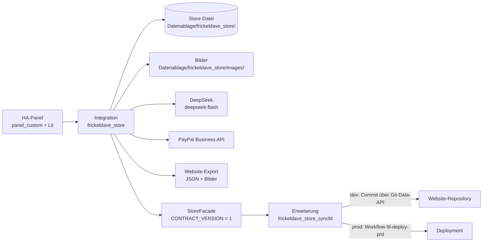

# FR008: Verwaltung der Handmade-Produkte in Home Assistant

Dieses Dokument beschreibt das Verwaltungswerkzeug für den Handmade-Katalog. Die bisherige Verwaltung
außerhalb von Home Assistant und die separate Pflege von `public/data/handmade.json` samt Bildern im
Website-Repository sind durch eine Custom Integration ersetzt. Produktdaten und Bilder liegen in
Home Assistant; den Katalog veröffentlicht die Website aus deren Export. Seit Basis 0.2.0 kommt die
Synchronisation nach frickeldave.de aus der eigenständigen Erweiterung `frickeldave_store_syncfd`
(siehe [Synchronisation als eigene Integration](#synchronisation-als-eigene-integration)).

- Issue: [#289](https://github.com/Frickeldave/frickeldave.github.io/issues/289)
- Integrations-Repository (Basis): <https://github.com/Frickeldave/homeassistant-frickeldave-store>
- Erweiterung: <https://github.com/Frickeldave/homeassistant-frickeldave-store-syncfd>
- Website-Katalog: [FR003 - Handmade Produktcatalog](../old/features/fr003-catalog.md)
- Status: Basis 0.2.3 mit dem überarbeiteten Veröffentlichungsdialog ist released, ebenso Erweiterung
  `frickeldave_store_syncfd` 0.1.4 mit der zielgenauen Meldung beim Prod-Publish und 0.1.5 mit der
  änderungsbasierten Deployment-Meldung. Basis 0.2.4 mit der reduzierten Übersicht im
  Veröffentlichungsdialog ist released. Basis 0.2.5 mit der einstellbaren Bildgrenze und der
  Speicherbelegung im Konfigurationspanel ist released. Basis 0.2.6 mit der automatischen
  Token-Erneuerung im Panel ist released. Basis 0.2.7 mit dem gemeinsamen Speichern-Button und dem
  korrigierten `fetchWithAuth`-Aufruf ist in Vorbereitung; Erweiterung 0.1.6 mit dem korrigierten
  Dispatch-Endpoint folgt. Finanz- und Kundenfunktionen bleiben geplant.

> Hinweis zur Repository-Bezeichnung: Die Spezifikation in #289 nennt
> `Frickeldave/frickeldave-store`. Am 27.10.2026 lag die Integration im Repository
> `Frickeldave/frickeldave.home.net`, seit dem 03.11.2026 heißt es
> `Frickeldave/homeassistant-frickeldave-store`. Dieses Dokument verwendet durchgehend den aktuellen
> Namen. Die Integrations-Domain bleibt `frickeldave_store`.

## Zweck und Umfang

Das Werkzeug führt die bisher getrennten Arbeitsabläufe in einer deutschen Oberfläche innerhalb von
Home Assistant zusammen:

- Produkte, Bilder, Tags, Sichtbarkeit und Bestände je Lagerstätte pflegen.
- Bestände als Buchungen nachvollziehen.
- Beschreibungen per KI vorschlagen lassen und erst nach bewusster Übernahme speichern.
- Kunden und – nach bestätigtem Schnittstellenumfang – PayPal-Artikel und -Kunden verwalten.
- Den Katalog für die Website exportieren. Veröffentlichen nach `dev` beziehungsweise `prod` und der
  Katalogimport kommen aus der Erweiterung `frickeldave_store_syncfd`.

Der Betrieb muss auf Home Assistant Container funktionieren: ohne Supervisor, ohne Add-on und ohne
zusätzlichen Anwendungscontainer. Die Integration ist damit eine normale Custom Integration, die
ausschließlich über HACS verteilt und über die Home-Assistant-Oberfläche eingerichtet wird. Das gilt
auch für die Erweiterung: Sie ist keine Add-on, sondern eine zweite Custom Integration, die HACS aus
einem eigenen Repository installiert.

## Architektur



### Integration und Verteilung

Seit 0.2.0 besteht das Werkzeug aus zwei Integrationen, jede mit eigenem Repository, eigener Domain
und genau einem Integrationsverzeichnis:

| Integration     | Domain                     | Repository                                           | Version |
| --------------- | -------------------------- | ---------------------------------------------------- | ------- |
| Basis           | `frickeldave_store`        | `Frickeldave/homeassistant-frickeldave-store`        | `0.2.7` |
| Synchronisation | `frickeldave_store_syncfd` | `Frickeldave/homeassistant-frickeldave-store-syncfd` | `0.1.6` |

- Basis: `custom_components/frickeldave_store/`.
- Erweiterung: `custom_components/frickeldave_store_syncfd/`.
- Verteilung jeweils als benutzerdefiniertes HACS-Repository vom Typ Integration. `hacs.json` führt
  Name und Mindestversion von Home Assistant; `manifest.json` führt `domain`, `name`, `version`,
  `documentation`, `issue_tracker` und `codeowners`.
- Versionierung nach SemVer, je Repository eigenständig; der Git-Tag entspricht der
  Manifest-Version ohne führendes `v`.
- Keine Supervisor- oder Add-on-Abhängigkeit: im Code beider Integrationen kommen keine `hassio`-
  oder Supervisor-Aufrufe vor.

### Oberfläche

- Das Panel wird als `panel_custom`-Web-Component mit Lit registriert, `embed_iframe=False`.
  Statische Assets werden über `async_register_static_paths` ausgeliefert.
- Kein Tailwind. Das Panel nutzt die HA-Design-Tokens (`--primary-color`, `--card-background-color`,
  `--primary-text-color`, `--secondary-text-color`, `--error-color`) und eine eigene
  `--fd-*`-Schicht im Shadow DOM. Daraus folgen Light/Dark und HA-Themes ohne eigene Umschaltung.
- Die Sprache der Oberfläche ist Deutsch.
- Panel und Konfigurationspanel laden ihre Module unter einer URL mit Versionsparameter
  (`?v=<Version>`); die Hilfsfunktion `module_url()` in `const.py` erzeugt ihn für
  `PANEL_MODULE_URL` und `CONFIG_PANEL_MODULE_URL`. Ein eigener Frontend-View liefert die Dateien
  zusätzlich mit `Cache-Control: no-cache, must-revalidate`. Beides verhindert, dass nach einem
  Update alte Module im Browser-Cache liegen (siehe
  [Aktualisierung und Browser-Cache](#aktualisierung-und-browser-cache)).
- Panel und Konfigurationspanel zeigen die geladene Version an; dieselbe Information liefert die
  API: `GET /api/frickeldave_store/me` gibt `version`, `storage_schema_version` und
  `panel_module_url` zurück, `GET /api/frickeldave_store/settings` und
  `PATCH /api/frickeldave_store/settings` geben `version` zurück. `GET /settings` liefert zusätzlich
  die Bildgrenze `images.max_bytes` und die Speicherbelegung `storage.usage` (siehe
  [Tab Allgemeine Einstellungen](#tab-allgemeine-einstellungen)).
- `require_admin` ist keine Zugangskontrolle, sondern steuert nur die Sichtbarkeit des Panels. Jede
  geschützte Route prüft die Berechtigung serverseitig (siehe [Berechtigungen](#berechtigungen)).

### Navigation

- Das Panel trägt oben eine Leiste im Stil von Home Assistant. Eine Tab-Leiste, die zwischen
  Produkten und Einstellungen wechselt, gibt es nicht mehr.
- Das Hamburger-Symbol links öffnet die Home-Assistant-Seitenleiste.
- Das Drei-Punkte-Menü rechts führt den Eintrag **Tags verwalten** (Pflege der Tags, sichtbar für
  die Rolle Produktpflege) und zeigt darunter die geladene Version, etwa `v0.1.14`. Die Version
  bestätigt, welcher Build tatsächlich läuft.
- Die Einstellungen der Integration liegen nicht im Panel, sondern in der Integrationsseite von Home
  Assistant: **Einstellungen → Geräte & Dienste → Frickeldave Store → Zahnrad** öffnet das
  Konfigurationspanel (siehe [Einrichtung und Optionen](#einrichtung-und-optionen)). Damit gibt es
  im Panel keinen Eintrag **KI** mehr.
- Einstellungen und Tag-Verwaltung liegen damit außerhalb der Hauptfläche. Die Hauptfläche bleibt
  der Produktliste und ihren Filtern vorbehalten.

### Datenhaltung

Standardmäßig liegen die Daten unter `config/frickeldave_store/` und damit im Backup. Die Auswahl des
Speicherorts im Tab [Allgemeine Einstellungen](#tab-allgemeine-einstellungen) verschiebt Store-Datei,
Bilder und Snapshots nach `/share/frickeldave_store/` oder `/media/frickeldave_store/`. Ob der
Katalog im Backup steckt, ist aus dieser Auswahl abgeleitet und nicht getrennt einstellbar.

| Zustand                         | Ablage                      | Backup-Verhalten                                                                         |
| ------------------------------- | --------------------------- | ---------------------------------------------------------------------------------------- |
| Speicherort `config` (Standard) | `config/frickeldave_store/` | enthalten, weil das HA-Backup das gesamte `config/`-Verzeichnis sichert                  |
| Speicherort `share`             | `/share/frickeldave_store/` | nur enthalten, wenn `share` in einem Teil-Backup ausgewählt oder vom Host gesichert wird |
| Speicherort `media`             | `/media/frickeldave_store/` | nur enthalten, wenn `media` in einem Teil-Backup ausgewählt oder vom Host gesichert wird |

| Inhalt        | Ablage unterhalb des gewählten Speicherorts          |
| ------------- | ---------------------------------------------------- |
| Metadaten     | `frickeldave_store.data` (JSON, atomar, versioniert) |
| Produktbilder | `images/<artikelnummer>/`                            |
| Snapshots     | `backups/<zeitstempel>-<anlass>.json`                |

Bilder gehören bewusst nicht in `.storage`. Beim Speicherort `config` liegen Daten und Bilder unter
`config/` und sind damit ohne Zusatzschritt im Backup enthalten. Mit dem Speicherort `share` oder
`media` lassen sie sich aus dem Backup heraushalten: Das eingebaute HA-Backup sichert `config/`
vollständig und bietet keine Ausnahme für einzelne Unterordner; `share` und `media` sind nur
enthalten, wenn der Ordner in einem Teil-Backup ausgewählt oder vom Host gesichert wird. Wer Home
Assistant Container betreibt, muss das gewählte Volume selbst in den Container einhängen.

Die im Konfigurationspanel angezeigte Belegung bezieht sich auf dieses effektive Datenverzeichnis.
Sie entsteht rekursiv aus den enthaltenen Dateien und Ordnern und folgt dabei keinen symbolischen
Links.

Datei-, Bild- und Netzwerkoperationen laufen nicht blockierend (Executor beziehungsweise `aiohttp`
mit Timeouts). Fehler externer Dienste werden abgefangen und dürfen Home Assistant nicht
beeinträchtigen.

### Persistenz und Datenverlust (bis 0.1.10)

Seit 0.1.11 liest und schreibt die Persistenzschicht die Store-Datei selbst: atomar, im gleichen
Envelope-Format (`version`, `minor_version`, `key`, `data`) wie zuvor und ohne Abhängigkeit von
Home-Assistant-Storage-Interna. Die Migration richtet sich nach `data.schemaVersion` in der
Store-Datei.

Der Umbau behebt einen Fehler, der bis 0.1.10 bei jedem Update den kompletten Katalog löschte:

- **Symptom:** Nach dem Einspielen einer neuen Integrationsversion waren alle Produkte verschwunden.
- **Ursache:** Home Assistants `Store`-Helper cached beim Start die Dateiliste von
  `<config>/.storage`. Der Katalog liegt aber unter
  `config/frickeldave_store/frickeldave_store.data` und damit außerhalb. `Store.async_load()` meldete
  deshalb „nicht vorhanden“; die Integration erzeugte einen leeren Store, und der nächste
  Schreibvorgang überschrieb die echte Datei mit `"products": []`. HACS-Updates lösen einen
  Home-Assistant-Neustart aus, deshalb trat das bei jedem Update auf.
- **Behebung:** Die Persistenzschicht liest und schreibt die Store-Datei selbst (atomar, gleiches
  Envelope-Format, Migration über `data.schemaVersion`), statt den HA-`Store`-Helper zu verwenden.
- **Sicherheitsnetz:** Ein Store mit Produkten wird nie durch einen Zustand mit 0 Produkten
  überschrieben (`refuse_empty_overwrite`). Vor Migrationen und vor dem ersten Schreiben nach dem
  Laden entstehen Snapshots unter `backups/`. Ein nicht lesbarer Store führt zu einem lauten Fehler
  statt zu einer leeren Liste.
- **Regressionstests:** `tests/test_upgrade_paths.py` prüft die Upgrade-Pfade 0.1.7 → aktuell,
  0.1.8 → aktuell und 0.1.9 → aktuell mit echten Store-Dateien. Auf dem alten Code schlugen sie fehl
  (0 statt 3 Produkte).

Die Anleitung für bereits Geschädigte steht unter
[Wiederherstellung nach dem Datenverlust-Bug](#wiederherstellung-nach-dem-datenverlust-bug-bis-0110).

### Migrationen

Schema-Änderungen laufen über `config_flow.VERSION`/`MINOR_VERSION` und `async_migrate_entry`.
Zusätzlich trägt jeder Datensatz eine Schema-Version. Migrationen sind idempotent und legen vor dem
Lauf einen Snapshot an. Seit 0.1.11 richtet sich die Migration der Store-Datei nach
`data.schemaVersion` und nicht nach der Envelope-Version (siehe
[Persistenz und Datenverlust](#persistenz-und-datenverlust-bis-0110)).

## Installation

1. Home Assistant Container mit laufender Oberfläche und installiertem HACS vorbereiten.
2. In HACS ein benutzerdefiniertes Repository anlegen: Repository-URL
   `https://github.com/Frickeldave/homeassistant-frickeldave-store`, Typ **Integration**.
3. Die Integration `frickeldave_store` installieren.
4. Home Assistant neu starten. Erst danach lädt die Custom Integration.
5. Die Integration über **Einstellungen → Geräte & Dienste → Integration hinzufügen** einrichten
   (siehe [Einrichtung und Optionen](#einrichtung-und-optionen)).
6. Das Panel erscheint anschließend in der HA-Seitenleiste.

Updates laufen über HACS: Ein neuer Git-Tag entspricht einer neuen Manifest-Version, HACS bietet das
Update an, nach der Installation ist ein Neustart von Home Assistant erforderlich. Ein Update
überlebt den Neustart, weil Daten und Bilder außerhalb des Integrationsverzeichnisses liegen —
standardmäßig unter `config/`, optional unter `/share` oder `/media` (siehe
[Datenhaltung](#datenhaltung)).

Die Aufnahme in den offiziellen HACS-Katalog ist nicht Teil der ersten Version; ein
benutzerdefiniertes Repository genügt.

Veröffentlichen und Katalogimport sind nicht Teil dieser Installation. Sie kommen mit der
Erweiterung `frickeldave_store_syncfd` hinzu, die nach der Basis installiert wird (siehe
[Synchronisation als eigene Integration](#synchronisation-als-eigene-integration)).

### Aktualisierung und Browser-Cache

Nach einem Update startet Home Assistant neu und lädt die Integration frisch; der Browser kann
trotzdem weiterhin die alten Panel-Module aus seinem Cache verwenden. Genau das trat nach dem
Update auf 0.1.9 auf: Der Desktop-Browser zeigte die alten Controls, die Android-App bereits die
neuen. Seit 0.1.10 verhindern der Versionsparameter und der Cache-Header an den Modul-URLs diesen
Fall dauerhaft (siehe [Oberfläche](#oberfläche)).

Seit 0.1.11 überlebt der Katalog auch das Update selbst: Der Datenverlust, der bis 0.1.10 bei jedem
Einspielen einer neuen Integrationsversion auftrat, ist behoben (siehe
[Persistenz und Datenverlust](#persistenz-und-datenverlust-bis-0110)).

Wenn die Oberfläche nach einem Update unverändert wirkt:

1. Die Seite mit `Strg+Shift+R` hart neu laden (macOS: `Cmd+Shift+R`).
2. Hilft das nicht, im Browser die Websitedaten für die Home-Assistant-URL löschen.
3. Die geladene Version prüfen: Sie steht im Drei-Punkte-Menü des Panels und in der Fußzeile des
   Konfigurationspanels. Sie muss zur in HACS installierten Version passen.

#### Versionsanzeige in Fußzeile und Modul-URL

Die Fußzeile des Konfigurationspanels zeigt die Version, die `GET /api/frickeldave_store/me` als
`version` meldet — also den Wert der Konstante `VERSION` aus `const.py` der geladenen Integration.
Dieselbe Konstante erzeugt den Cache-Bust-Parameter der Modul-URL (`?v=<Version>`), unter der Panel
und Konfigurationspanel ihre Module laden. Beide Anzeigen hängen damit an derselben Quelle.

Genau hier lag der Fehler bis 0.2.1: `VERSION` in `const.py` blieb auf `0.2.0` stehen, während der
Release nur `manifest.json` und `pyproject.toml` erhöhte. Nach dem Update auf 0.2.1 zeigte die
Fußzeile deshalb weiterhin `0.2.0`, und die Modul-URL blieb unverändert — der Browser konnte das
alte Panel-Modul aus seinem Cache verwenden. Seit 0.2.2 stimmt die Konstante mit dem Manifest
überein; ein Test hält beide Werte zusammen. Fußzeile und Modul-URL tragen damit die veröffentlichte
Version.

Zeigt die Fußzeile nach einem Update trotzdem eine alte Version:

1. Prüfen, ob HACS das Update installiert hat, und Home Assistant neu starten. Ohne Neustart läuft
   die alte Integration weiter.
2. Die Seite hart neu laden (`Strg+Shift+R`, macOS: `Cmd+Shift+R`) oder die Websitedaten für die
   Home-Assistant-URL löschen.
3. Erst wenn Fußzeile und installierte Version übereinstimmen, ist der Build aktuell.

## Einrichtung und Optionen

Einrichtung und Optionen erfolgen ausschließlich über Config Flow und Options Flow. Eine
YAML-Konfiguration gibt es nicht.

- Der Config Flow legt die Integration an und registriert das Panel.
- Der Options Flow öffnet das Konfigurationspanel der Integration. Erreichbar ist es über
  **Einstellungen → Geräte & Dienste → Frickeldave Store → Zahnrad**.
- Das Konfigurationspanel umfasst die Tabs **Allgemeine Einstellungen**, **Benutzerverwaltung**,
  **KI-Einstellungen** und **Lagerstätten**; die Lagerstätten pflegt die Administration im Tab
  **Lagerstätten** (**Einstellungen → Geräte & Dienste → Frickeldave Store → Zahnrad → Tab
  „Lagerstätten“**, siehe [Lagerstätten](#lagerstätten)). Einen Tab **Veröffentlichen** gibt es seit
  0.2.0 nicht mehr; Token, Repository und Zielbranches pflegt der Options-Flow der Erweiterung (siehe
  [Synchronisation als eigene Integration](#synchronisation-als-eigene-integration)).
- Zugangsdaten bleiben serverseitig und erscheinen nicht in Logs, Diagnose oder Export.
- Jede Option der Konfigurationsdokumentation entspricht genau einem Feld der Oberfläche; weitere
  Felder führt dieses Dokument nicht.

### Tab Benutzerverwaltung

Der Tab bildet die Rollenfreigaben aus [Berechtigungen](#berechtigungen) ab.

- Die Liste zeigt alle freigegebenen Benutzer mit ihrem echten Home-Assistant-Namen und den
  zugeordneten Rollenbezeichnungen: **Produktpflege**, **Finanzen**, **Anwendungsverwaltung**.
- Das Zahnrad je Benutzer öffnet den Rolleneditor: zwei Listen stehen nebeneinander, links die
  verfügbaren Rollen und rechts die zugeordneten Rollen. Die Schaltflächen dazwischen fügen eine
  markierte Rolle hinzu oder entfernen sie wieder.
- Das Papierkorb-Symbol je Benutzer entfernt dessen Freigabe vollständig. Der Benutzer verliert
  damit jeden Zugriff und erhält auf geschützten Routen `403` (Default Deny).
- **Benutzer hinzufügen** steht oberhalb der Liste: Auswahl eines Home-Assistant-Benutzers und
  derselbe Rolleneditor wie beim Bearbeiten. Die Zuordnung erfolgt über die stabile HA-Benutzer-ID.
- Mindestens eine Freigabe mit der Rolle **Anwendungsverwaltung** muss bestehen bleiben. Das
  Entfernen der letzten Freigabe oder der letzten Anwendungsverwaltung wird abgewiesen, damit sich
  niemand selbst aussperrt.
- Der Tab selbst ist nur für die Rolle **Anwendungsverwaltung** zugänglich.

### Tab KI-Einstellungen

- Der Tab pflegt den KI-Anbieter mit genau vier Feldern: Endpunkt, Modell, API-Key und Prompt.
- Der API-Key ist write-only: Er lässt sich setzen und ersetzen, wird aber nie im Klartext
  angezeigt. Gespeichert wird er serverseitig; Logs, Diagnose und Export enthalten ihn nicht.
- Die Felder entsprechen den Angaben unter
  [KI-Beschreibungsvorschläge](#ki-beschreibungsvorschläge).
- Der Tab selbst ist nur für die Rolle **Anwendungsverwaltung** zugänglich.

### Tab Allgemeine Einstellungen

Der Tab steht an erster Stelle des Konfigurationspanels und zeigt, wo der Katalog liegt und wie viel
Platz er belegt. Frühere Fassungen dieses Dokuments nannten ihn bereits, obwohl er im Code fehlte;
seit 0.1.14 beschreiben die folgenden Angaben den tatsächlichen Stand.

- Ein Schalter zeigt, ob der Produktkatalog im Home-Assistant-Backup enthalten ist. Sein Zustand
  folgt dem Speicherort und ist kein eigenes Feld: `config` heißt enthalten, `share` und `media`
  heißen nicht enthalten.
- Die Auswahl des Speicherorts bietet die angebotenen Optionen mit einer Beschreibung je Option.
- Schreibgeschützt darunter stehen der effektive Pfad und die drei Unterpfade für Metadaten, Bilder
  und Snapshots (siehe [Datenhaltung](#datenhaltung)).
- Eine kompakte Zeile **Belegt: …** fasst die Speicherbelegung des Stores zusammen, etwa
  „Belegt: 128 MB · Bilder 96 MB · Metadaten 2 MB · Snapshots 30 MB · 412 Dateien“. Die Werte
  stammen aus `storage.usage` in `GET /api/frickeldave_store/settings`; das Objekt führt
  `total_bytes` (Gesamt), `data_bytes` (Metadaten), `images_bytes` (Bilder), `backups_bytes`
  (Snapshots) und `files` (Anzahl der Dateien).
- Die Belegung berechnet die Integration rekursiv über das effektive Datenverzeichnis — je nach
  Speicherort `config`, `share` oder `media` — und folgt dabei keinen symbolischen Links. Nach einem
  Wechsel des Speicherorts zeigt die Zeile deshalb den neuen Ordner.
- Der Abschnitt **Bilder** führt das Feld **Maximalgröße (kB)**. Es setzt die Obergrenze für die
  Dateigröße eines Produktbilds; erlaubt sind 50 bis 10240 kB, der Standard ist 500 kB. Die lange
  Kante bleibt davon unberührt und liegt weiterhin bei 1600 px (siehe [Bilder](#bilder)).
- `images.max_bytes` und `storage.usage` liefert `GET /api/frickeldave_store/settings`;
  `storage.usage` ist schreibgeschützt, gesetzt wird nur `images.max_bytes`.
- Ein einziger Button **Einstellungen speichern** schreibt Speicherort samt Backup-Schalter und die
  Bild-Maximalgröße gemeinsam über `PATCH /api/frickeldave_store/settings`. Den separaten Button
  „Bildgröße speichern“ gibt es seit 0.2.7 nicht mehr. Der PATCH enthält nur die geänderten
  Abschnitte: `storage` für den Speicherort, `images` für die Maximalgröße.
- **Änderung verwerfen** setzt Speicherort samt Backup-Schalter und die Bild-Maximalgröße auf die
  zuletzt gespeicherten Werte zurück.
- Ein Wechsel des Speicherorts wird erst nach einem Neuladen der Integration wirksam; die
  Oberfläche teilt das ausdrücklich mit und nennt den Weg **Einstellungen → Geräte & Dienste →
  Frickeldave Store → Neu laden**. Eine geänderte Bild-Maximalgröße wirkt ohne Neuladen.
- Ein Wechsel verschiebt Store-Datei, Bilder und Snapshots an den neuen Ort. Die alte Kopie bleibt
  für die manuelle Bereinigung liegen; die Integration löscht sie nicht.
- Ist der Zielordner belegt, antwortet der Server mit `409`, fehlt der Mount, mit `400`. Die
  Oberfläche zeigt die Servermeldung, und die Auswahl springt zurück.
- Der Tab selbst ist nur für die Rolle **Anwendungsverwaltung** zugänglich.

### Lagerstätten

Unter **Einstellungen → Geräte & Dienste → Frickeldave Store → Zahnrad → Tab „Lagerstätten“** pflegt
die Administration die Lagerstätten: anlegen, umbenennen, löschen. Voreingestellt sind **Lager** und
**Verkaufsschrank**.

- Mindestens eine Lagerstätte muss bestehen bleiben.
- Namen sind eindeutig und dürfen nicht leer sein.
- Das Löschen einer Lagerstätte mit Bestand größer 0 wird mit einer deutschen Fehlermeldung
  abgelehnt.
- Bestände werden pro Lagerstätte geführt; die Lagerstätten-IDs bleiben beim Umbenennen stabil.
- Die Migration von Schema-Version 1 auf 2 erhält die bestehenden Bestände (siehe
  [Bestandsmodell](#bestandsmodell)).
- Die Reihenfolge der Lagerstätten bestimmt den Website-Export (siehe
  [Website-Export](#website-export)).

## Datenmodell (Schema-Version 2)

Ein Produkt besteht aus:

| Feld            | Typ                | Bedeutung                                                            |
| --------------- | ------------------ | -------------------------------------------------------------------- |
| `articleNumber` | string (6 Zeichen) | Kategoriepräfix plus Zufallszeichen, Primärschlüssel, unveränderlich |
| `name`          | string             | Produktname                                                          |
| `description`   | string             | Beschreibung                                                         |
| `category`      | Code               | `3D`, `EP`, `LA`, `SB` oder `WO`, genau eine je Produkt              |
| `price`         | Dezimal            | Preis in Euro                                                        |
| `size`          | string             | Größenangabe                                                         |
| `tags`          | string[]           | frei wählbare Tags, öffentliche Filter                               |
| `customizable`  | boolean            | Personalisierbar (Auftragsproduktion)                                |
| `visible`       | boolean            | Sichtbarkeit auf der Website                                         |
| `stock`         | Objekt             | Stückzahl je Lagerstätte, Schlüssel ist die Lagerstätten-ID          |
| `images`        | Liste              | maximal zehn Bilder, geordnet, genau ein Hauptbild                   |
| `archived`      | boolean            | Soft-Delete                                                          |
| `createdAt`     | Zeitstempel        | Anlage                                                               |
| `updatedAt`     | Zeitstempel        | letzte Änderung                                                      |
| `schemaVersion` | integer            | Schema-Version des Datensatzes, aktuell `2`                          |

Regeln:

- `articleNumber` ist sechs Zeichen lang, beginnt mit dem Kategoriepräfix und bleibt nach dem
  Anlegen unverändert. Die Eindeutigkeit wird beim Anlegen geprüft, auch bei paralleler Erstellung.
- Ein Kategoriewechsel nach dem Anlegen ist nicht möglich. Stattdessen wird ein neues Produkt
  angelegt.
- Löschen gibt es nur als Soft-Delete über `archived`. Ein Hard-Delete-Pfad existiert nicht.
- Importquelle ist der bestehende Live-Katalog `public/data/handmade.json` mit 63 Produkten und fünf
  Kategorien samt Bildordnern; der Ablauf steht unter [Katalogimport](#katalogimport).
- Die Felder `stock` und `salesCabinet` existieren im Live-Katalog bereits, werden von der Website
  aber noch nicht ausgewertet; siehe [FR003](../old/features/fr003-catalog.md).
- `stock` ist seit Schema-Version 2 ein Objekt Lagerstätten-ID → Stückzahl. Die Migration von
  Version 1 auf 2 erhält bestehende Bestände; Details stehen im
  [Bestandsmodell](#bestandsmodell).
- Ein Bildeintrag führt `bytes`, `width`, `height`, `content_type` und `oversized`. Die Werte
  ermittelt die Integration beim Lesen aus den Bilddateien; sie stehen nicht in der Store-Datei
  (siehe [Bilder](#bilder)).

### Kategorien

| Code | Kategorie  | Bedeutung              |
| ---- | ---------- | ---------------------- |
| `3D` | 3D-Druck   | 3D-gedruckte Produkte  |
| `EP` | Epoxidharz | Epoxidharz-Produkte    |
| `LA` | Laser      | lasergeschnittene Ware |
| `SB` | Steinmasse | Steinmasse-Produkte    |
| `WO` | Holz       | Holzprodukte           |

### Suche, Filter und Sortierung

- Suche über Name, Beschreibung, Artikelnummer und Tags.
- Filter: Kategorie, Tags, personalisierbar, Sichtbarkeit sowie Bestand je Lagerstätte.
- Lagerstätte: Die Auswahl einer Lagerstätte zeigt standardmäßig nur Produkte mit Bestand größer 0
  in dieser Lagerstätte (`in_location=true`).
- Die Checkbox **„Auch Produkte ohne Bestand anzeigen“** (Standard aus) erweitert das Ergebnis auf
  alle Produkte der gewählten Lagerstätte (`in_location=false`). Der Hinweistext unter dem
  Auswahlfeld beschreibt genau dieses Verhalten.
- Eine gewählte Lagerstätte zählt als aktiver Filter: Sie setzt das Badge **Filter aktiv** und
  aktiviert **Filter zurücksetzen**. Der Opt-out allein zählt nicht.
- Verknüpfung: Kategorie ODER, Tags ODER, alle übrigen Filter UND.
- Suchfeld, Umschalter **Kacheln** / **Liste** und **Filter zurücksetzen** stehen auf gemeinsamer
  Höhe (`--fd-control-height: 48px`); das Suchlabel ist nur für Screenreader sichtbar.
- Die Filterleiste ist zuklappbar. Der Kopf **Suche und Filter** trägt einen Chevron und steuert den
  Bereich über `aria-expanded` und `aria-controls`; der Zustand bleibt in `localStorage` unter
  `fd-store-filters-open` erhalten, Standard ist offen. Zugeklappt bleibt das Badge **Filter aktiv**
  sichtbar, sobald ein Filter gesetzt ist.
- Auf breiten Desktop-Monitoren stehen Kategorien und Tags nebeneinander; erklärende Hilfssätze
  entfallen.
- Sortierung über sechs Felder: Produkt, Kategorie, Preis, Größe, Bestand und Status. In der
  Listenansicht übernehmen das die Spaltenköpfe, in der Kachelansicht der Umschalter in der
  Filterleiste; beide teilen denselben Zustand. Die Sortierung bleibt bei Filteränderungen erhalten.
  Details stehen unter [Sortierung](#sortierung).
- Bildverwaltung: maximal zehn Bilder je Produkt, Reihenfolge und genau ein Hauptbild. Ein elfter
  Upload wird mit Meldung abgelehnt, ohne Teilpersistenz. Der Server verkleinert Uploads (siehe
  [Bilder](#bilder)).

## Produktpflege im Panel

### Ansichten und Toolbar

Die Produktliste erscheint wahlweise als Kachel- oder Listenansicht. Der Umschalter **Kacheln** /
**Liste** sitzt in der Toolbar; die Auswahl bleibt über ein Neuladen des Panels erhalten
(`localStorage`, Schlüssel `fd-store-view`).

- Beide Ansichten zeigen Bild, Name, Artikelnummer, Kategorie, Preis, Tags, Status und Bestände.
- Die Listenansicht führt die Spalte **Größe**: Sie zeigt die Summe aller Bilddateien des Produkts,
  also aller Bilder und nicht nur des Hauptbilds. Gemeint ist damit der Speicherbedarf der Bilder,
  nicht die Größenangabe **Größe** aus den Grunddaten. Die Anzeige nutzt deutsches Zahlenformat in KB
  oder MB, Produkte ohne Bilder zeigen `—`. Die Spalte sortiert wie die übrigen (siehe
  [Sortierung](#sortierung)).
- Die Listenansicht ist kompakt: Thumbnail 40 px statt 56 px, Zell-Padding 4 px statt 8 px, Tags
  einzeilig mit Umbruch. **Bearbeiten** und **Archivieren** sind Icon-Buttons (Stift, Archivbox)
  nebeneinander, jeweils mit `aria-label` und `title` sowie 44 × 44 px Touch-Ziel.
- Status und Bestände folgen den konfigurierten Lagerstätten; die Bezeichnungen der Bestandsfilter
  richten sich nach deren Namen (siehe [Lagerstätten](#lagerstätten)).
- In der Statusspalte sitzen die Badges **Personalisierbar** und „Bilder zu groß“ in gleicher Höhe;
  treffen beide zu, stehen sie auf einer Zeile.

### Sortierung

Die Spaltenköpfe **Produkt**, **Kategorie**, **Preis**, **Größe**, **Bestand** und **Status** der
Listenansicht sind klickbar und zeigen einen Sortierpfeil; `aria-sort` markiert die aktive Spalte und
die Richtung.

- **Produkt** sortiert nach Name, **Kategorie** nach dem Kategorie-Label, **Preis** nach dem Preis.
- **Größe** sortiert nach der Summe der Bild-Bytes des Produkts.
- **Bestand** sortiert nach dem Gesamtbestand über alle Lagerstätten, unabhängig vom
  Lagerstätten-Filter.
- **Status** sortiert aktiv vor archiviert und sichtbar vor unsichtbar.
- Die Sortierung läuft serverseitig vor der Pagination. „Größte Produkte“ gilt damit über alle
  Treffer, nicht nur über die geladene Seite.
- Der erste Klick sortiert aufsteigend, ein erneuter Klick dreht die Richtung. `desc` dreht nur das
  Hauptkriterium; Gleichstände bleiben aufsteigend, zuerst nach Name, dann nach Artikelnummer.

Der Sortier-Umschalter in der Filterleiste bleibt für die Kachelansicht und bietet jetzt alle sechs
Felder. Beide Bedienelemente teilen denselben Sortierzustand.

### Produktdialog

**Neues Produkt** und **Produkt bearbeiten** öffnen denselben Dialog mit vier Tabs in dieser
Reihenfolge:

| Tab          | Inhalt                                                                           |
| ------------ | -------------------------------------------------------------------------------- |
| Grunddaten   | Name, Kategorie, Preis, Größe, Tags, Sichtbarkeit und Personalisierbar           |
| Bilder       | Bildverwaltung: maximal zehn Bilder, Reihenfolge, Hauptbild, Löschen, Optimieren |
| Beschreibung | Beschreibungsfeld, „Eigene Hinweise“ für die KI und „Beschreibung vorschlagen“   |
| Bestand      | Bestände je Lagerstätte und Buchungshistorie                                     |

- Einen separaten Bilder-Dialog gibt es nicht mehr; die Bildverwaltung liegt vollständig im Tab
  **Bilder**. Einen separaten **Bestand**-Button in der Produktkarte gibt es ebenfalls nicht mehr.
- Oben links im Dialogkopf steht die Artikelnummer in einem farbigen Badge. Den bisherigen
  Untertitel „Artikelnummer …“ gibt es nicht mehr.
- Beim Anlegen schlägt die Oberfläche die Nummer live über
  `GET /api/frickeldave_store/products/article-number?category=<Code>` vor. Während des Ladens steht
  der Platzhalter „…“, bei einem Fehler wie fehlender Kategorie „—“.
- Die Vorschau reserviert nichts. Nach dem Speichern gilt die vom Server vergebene Nummer.
- Der Footer-Button heißt beim Anlegen auf **Grunddaten**, **Bilder** und **Beschreibung**
  **Weiter**, auf **Bestand** **Speichern**.
- **Weiter** auf **Grunddaten** legt das Produkt an, damit Bilder hochgeladen werden können, und
  wechselt in den Bearbeiten-Modus. Auf den Folgetabs speichert **Weiter** die Änderungen und
  wechselt zum nächsten Tab.
- Validierungsfehler blockieren den Tabwechsel und springen zum betroffenen Tab.
- Nach dem Anlegen weist der Dialog darauf hin, dass das Produkt bereits gespeichert ist und
  **Schließen** nur den Dialog beendet.
- Der Tab **Beschreibung** enthält das Beschreibungsfeld, die **Eigenen Hinweise** für die KI und
  **Beschreibung vorschlagen** samt Übernahme des Vorschlags (siehe
  [KI-Beschreibungsvorschläge](#ki-beschreibungsvorschläge)).
- Der Tab **Bestand** zeigt je Lagerstätte eine Spalte mit Plus- und Minus-Symbolschaltfläche um
  die Nummernbox. Beide Symbole sind gleich breit wie die Nummernbox; **Minus** ist bei Menge 0
  deaktiviert. Direkte Zahleneingabe ist möglich, das Minimum ist 0. Gespeichert wird beim Speichern
  des Produkts.
- Die Buchungshistorie steht als Abschnitt im Tab **Bestand**.

### Bilder

Der Tab **Bilder** des Produktdialogs nimmt Uploads entgegen; der Server verarbeitet jedes Bild und
legt keine unveränderten Handyfotos mehr ab. Bis 0.1.13 wanderten die Bildbytes in voller Größe in
Backup und Export, begrenzt nur durch das Upload-Limit von 10 MB.

Die Grenze für die lange Kante bleibt bei 1600 px. Die zulässige Dateigröße ist seit Basis 0.2.5
einstellbar: Im Tab [Allgemeine Einstellungen](#tab-allgemeine-einstellungen) setzt das Feld
**Maximalgröße (kB)** unter **Bilder** die Grenze; erlaubt sind 50 bis 10240 kB, voreingestellt sind
500 kB. Bis 0.2.4 lag die Grenze fest bei 400 KiB. Jedes Bild über der eingestellten Grenze trägt
`oversized`, das Panel warnt mit Anzahl und Schwellwerten und bietet **Bilder optimieren** an.

| Fall                                                            | Ergebnis                                       |
| --------------------------------------------------------------- | ---------------------------------------------- |
| Lange Kante über 1600 px                                        | auf 1600 px verkleinert, nie hochskaliert      |
| JPEG                                                            | Qualität 82, progressiv, EXIF und ICC entfernt |
| PNG oder WebP mit Transparenz                                   | WebP, Qualität 85, Alpha erhalten              |
| PNG ohne Transparenz                                            | JPEG, Qualität 82                              |
| GIF und animiertes WebP                                         | unverändert übernommen                         |
| Bereits passend (höchstens 1600 px **und** eingestellte Grenze) | Bytes unverändert, kein Re-Encoding            |

Die Verarbeitung liegt im neuen Modul `imaging.py` und läuft im Executor. Pillow ist in Home
Assistant enthalten und damit keine zusätzliche Abhängigkeit; gegen Dekomprimierungsbomben gilt eine
Grenze von 40 Megapixeln. Die Dateiendung folgt dem Ergebnis, ein PNG mit Transparenz wird also
`.webp`. Die Upload-Antwort nennt Original und Ergebnis (`bytes`, `width`, `height`,
`content_type`), `resized` und eine deutsche Meldung, etwa „Bild von 12,0 MB auf 278 KB verkleinert
(4032×3024 → 1600×1200)“.

**Metadaten in der API.** Jedes Bild führt `bytes`, `width`, `height`, `content_type` und
`oversized` (lange Kante über 1600 px oder Dateigröße über `images.max_bytes`). Die Werte ermittelt
die Integration beim Lesen aus den Dateien und speichert sie nicht im Store; eine Migration entfällt.
Ein prozesslokaler LRU-Cache (Schlüssel: Pfad, mtime, Größe) hält die Produktliste schnell — gemessen
26 ms für 600 Bilder im warmen Zustand, 153 ms kalt.

**Sammel-Optimierung.** `POST /api/frickeldave_store/products/{artikelnummer}/images/optimize`
verkleinert alle zu großen Bilder eines Produkts nach denselben Regeln. Reihenfolge und Hauptbild
bleiben erhalten, vor dem Lauf entsteht ein Snapshot, und wiederholte Aufrufe ändern nichts mehr.
Die Antwort liefert je Bild vorher und nachher sowie eine Statistik (`count`, `bytes_before`,
`bytes_after`, `saved_percent`); Teilfehler meldet sie je Bild, ohne den Lauf abzubrechen.

**Oberfläche.** Nach jedem Upload erscheint die Verkleinerungsmeldung, bei bereits passenden Bildern
eine ruhige Bestätigung und bei einem GIF der Hinweis, dass es unverändert übernommen wurde. Im Tab
**Bilder** steht je Bild „1600 × 1200 · 278 KB“; zu große Bilder tragen ein Warndreieck mit
Detailhinweis, über der Liste steht ein Warnbanner mit Anzahl und den geltenden Schwellwerten
(1600 px lange Kante und eingestellte Maximalgröße) und darunter der Button **Bilder optimieren** —
deaktiviert, wenn nichts zu tun ist, sonst mit Ergebnis und Ersparnis in Prozent. In der Kachel sitzt
das Warndreieck als Badge am Bild, in der Liste in der Statusspalte mit dem Text „Bilder zu groß“;
sein Tooltip lautet „Mindestens ein Bild ist zu groß. Produkt öffnen und Bilder optimieren.“, und ein
Klick öffnet den Bilder-Tab. In der Liste ist das Badge genauso hoch wie das Badge
**Personalisierbar**; treffen beide zu, stehen sie auf einer Zeile.

### Katalogimport

Der Katalogimport gehört seit Basis 0.2.0 zur Erweiterung `frickeldave_store_syncfd`. Solange diese
nicht registriert ist, ist der Button **Katalog importieren** nicht vorhanden; danach erscheint er und
ist aktiv, weil der Import keine weitere Voraussetzung hat (siehe
[Verhalten ohne und mit Erweiterung](#verhalten-ohne-und-mit-erweiterung)). Ein Klick öffnet den
Importdialog. Beim Öffnen läuft automatisch ein Dry-Run; dabei wird nichts geschrieben.

- Die Vorschau nennt, wie viele Produkte neu angelegt, überschrieben, unverändert gelassen und
  fehlerhaft wären, und wie viele Bilder importiert würden. Eine deutsche Zusammenfassung beschreibt
  das Ergebnis.
- Standardmäßig werden vorhandene Produkte nicht verändert: Die Checkbox **Bestehende Produkte
  überschreiben** ist aus.
- Ist die Checkbox aktiv, erscheint ein Warnbanner und die Vorschau wird mit `overwrite` neu geladen.
- Überschrieben werden Name, Beschreibung, Preis, Größe, Tags, Sichtbarkeit, Personalisierbarkeit
  und Bestand. Erhalten bleiben Artikelnummer, Anlagedatum, Bilder, Buchungen, Archiv-Status und
  Kategorie.
- Nach dem Import zeigt der Dialog die angelegten, überschriebenen, übersprungenen und fehlerhaften
  Produkte, die importierten Bilder und eine Fehlerliste je Artikelnummer.

### Aktualisieren

Der Button **Aktualisieren** lädt Produkte, Tags und Einstellungen neu aus der Integration. Er
überträgt nichts an die Website und löst kein Deployment aus. Für beides sind ausschließlich die
Aktionen unter [Veröffentlichen](#veröffentlichen) zuständig, die mit der Erweiterung
`frickeldave_store_syncfd` dazukommen.

## Bestandsmodell

Bestände werden je Lagerstätte geführt. `stock` ist ein Objekt, das jeder Lagerstätten-ID eine
Stückzahl zuordnet. Kacheln, Liste, Filter, Editor und der Tab **Bestand** verwenden die
konfigurierten Namen.

- Voreingestellt sind **Lager** und **Verkaufsschrank**; die Administration pflegt sie im
  Konfigurationspanel (siehe [Lagerstätten](#lagerstätten)).
- Die Bestandsfilter richten sich nach den konfigurierten Lagerstätten und tragen deren Namen.
- Bestandsänderungen werden als Buchungen erfasst: Zugang, Abgang, Umlagerung, Korrektur.
- Jede Buchung trägt einen Zeitstempel und den auslösenden HA-Benutzer.
- Einzelstücke sind Produkte mit Menge 1.
- Personalisierbare Produkte sind Auftragsproduktion; Verkäufe buchen sie nicht automatisch ab.
- Eine Umlagerung ist eine Buchung zwischen zwei Lagerstätten, keine direkte Feldänderung.

## Website-Export

Die Integration ist führend, die Website konsumiert den Export.

- Der Export enthält ein JSON im bestehenden Schema von `public/data/handmade.json`, inklusive
  `stock` und `salesCabinet`. Die erste Lagerstätte wird zu `stock`, die zweite zu `salesCabinet`;
  ohne zweite Lagerstätte ist `salesCabinet` 0. Maßgeblich ist die Reihenfolge, nicht der Name.
- Exportiert werden ausschließlich nicht archivierte Produkte. `archived` und `visible` werden
  korrekt abgebildet.
- Die Artikelnummer bleibt der Schlüssel; wiederholte Exporte sind idempotent.
- Bilder werden als Dateien mitgeliefert; die Veröffentlichung legt sie im Website-Repository unter
  `src/assets/handmade/<kategorie>/<artikelnummer>/` nach dem bestehenden Muster
  `<artikelnummer>-NN.jpg` ab. Das erste Bild in Sortierreihenfolge ist das Hauptbild.

**Stabile Bilddateinamen.** Bis 0.1.14 nummerierte der Export die Bilder nach ihrer Position: Das
Hauptbild bekam `-01`, die übrigen `-02`, `-03` und so weiter. Das Löschen eines Bildes verschob
damit alle folgenden Nummern, und im Repository erschien eine Umbenennung wie `LAKBCD-08 →
LAKBCD-04` als `removed` plus `added`, obwohl sich nur die Reihenfolge geändert hatte. Seit 0.1.15
bleibt das Hauptbild `-01`, und jedes weitere Bild behält seine Store-Nummer, solange sie frei ist.
Das Löschen eines Bildes erzeugt deshalb nur einen `removed`-Eintrag. Verwenden zwei Produkte
dasselbe Foto, liegen die Dateien getrennt unter `images/<artikelnummer>/`; identische Bildinhalte
sind kein Fehler.

Der Export endet lokal. Den Transport übernimmt die Erweiterung `frickeldave_store_syncfd`: `dev`
wird per Commit über die Git-Data-API geschrieben, `prod` über den Workflow `fd-deploy-prd`. Siehe
[Veröffentlichen](#veröffentlichen) und
[Synchronisation als eigene Integration](#synchronisation-als-eigene-integration).

## Veröffentlichen

Veröffentlichen ist seit Basis 0.2.0 keine Funktion der Basis mehr, sondern kommt aus der
Erweiterung `frickeldave_store_syncfd` (siehe
[Synchronisation als eigene Integration](#synchronisation-als-eigene-integration)). Ohne diese
Erweiterung existieren die folgenden Aktionen nicht.

Seit Basis 0.2.1 sind die Buttons in diesem Fall vollständig ausgeblendet; 0.2.0 zeigte sie noch
sichtbar und deaktiviert. Ist die Erweiterung registriert, aber noch kein Token hinterlegt, bleiben
beide sichtbar, sind deaktiviert und nennen den Grund (siehe
[Verhalten ohne und mit Erweiterung](#verhalten-ohne-und-mit-erweiterung)).

Mit installierter Erweiterung stehen für die Rolle **Anwendungsverwaltung** (`app_admin`) in der
Topbar zwei Icon-Buttons neben **Aktualisieren**, **Katalog importieren** und **Produkt erstellen**:

- **Nach dev veröffentlichen**: schreibt den Export per Commit über die Git-Data-API in das
  Website-Repository `Frickeldave/frickeldave.github.io`.
- **Nach prod veröffentlichen**: löst nach dem Commit den Workflow `fd-deploy-prd` aus. Das ist der
  einzige Weg, auf dem `main` aktualisiert wird.

Beide Buttons tragen dasselbe Branch-Symbol und unterscheiden sich nur durch ein kleines Badge
`dev` beziehungsweise `prd`. Screenreader-Text und Tooltip nennen weiterhin das Ziel: „Nach dev
veröffentlichen“ und „Nach prod veröffentlichen“.

Eine Karte **Website veröffentlichen** gibt es nicht mehr. Der Ablauf über den
[Dry-Run](#dry-run)-Dialog bleibt unverändert: Beide Aktionen starten zuerst den Dry-Run;
veröffentlicht wird erst nach Bestätigung. Nach Erfolg zeigt das Panel das Ziel, den Commit und ob
ein Deployment ausgelöst wurde.

Voraussetzung ist ein GitHub-Token im Options-Flow der Erweiterung unter **Einstellungen → Geräte &
Dienste → Frickeldave Store Sync**; die nötigen Berechtigungen stehen unter
[Token-Berechtigungen](#token-berechtigungen). Das Feld ist write-only; die Oberfläche zeigt nur
**Token hinterlegt**.

### Produktions-Deploy ohne Versions-Bump

Ein Prod-Publish mit Katalog- und Produktbildänderungen braucht seit dem Katalog-Schnellweg keinen
Versions-Bump mehr:

- `fd-deploy-prd` vergleicht den Diff `main..dev`. Enthält er mindestens einen Katalogpfad —
  `public/data/handmade.json` oder ein Bild nach dem Muster
  `src/assets/handmade/<3D|EP|LA|SB|WO>/<Artikel>/<Artikel>-NN.<Endung>` — und keinen
  seitenrelevanten Pfad, mergt der Workflow nach `main` und deployt Pages, ohne die Version zu
  erhöhen.
- Deploy-neutrale Änderungen, die auf `dev` warten, reisen mit: Dokumentation, Entscheidungsnotizen
  unter `.squad/`, Workflow- und Tooling-Anpassungen sowie Tests und `CHANGELOG.md`. Sie verändern
  das gebaute Seitenartefakt nicht und blockieren den Katalog-Publish deshalb nicht mehr.
- Seitenrelevanter Code wird nie mitgenommen: `src/**`, `public/**` außer dem Katalog,
  Build-Konfigurationen wie `astro.config.mjs` und `package.json` sowie `scripts/build-*` und
  `scripts/install-*` verlangen weiterhin einen regulären Release mit Versions-Bump.
- Die Footer-Version der Website bleibt bei einem Fast-Path-Deploy gleich; sie ändert sich nur mit
  einem Release. Tag und GitHub-Release entstehen ausschließlich, wenn `package.json` höher steht
  als das letzte stabile Release.
- Der erste Lauf mit diesem Weg ist der normale Release 1.0.12; er bringt die neue
  Workflow-Fassung erstmals nach `main`. Solange `main` sie noch nicht trägt, verhält sich ein
  Prod-Publish wie bisher und erwartet einen Versions-Bump.

Details zu beiden Gates, `force_deploy` und dem Rollback stehen unter
[Versionierung und Release](../workflow/versionierung%20und%20release.md).

### Fehler beim Veröffentlichen nach prod

Meldet das Veröffentlichen nach prod „Repository … oder Branch nicht gefunden. Bitte Repository und
Token prüfen.“, ist der Commit nach `dev` bereits geschrieben; fehlgeschlagen ist der
Workflow-Dispatch, der `fd-deploy-prd` startet. Zwei Prüfungen klären die Ursache:

1. **Options-Flow der Erweiterung** (**Einstellungen → Geräte & Dienste → Frickeldave Store Sync**):
   Das Feld **Repository** muss `Frickeldave/frickeldave.github.io` enthalten, das Feld
   **Prod-Workflow** den Dateinamen mit Endung, also `fd-deploy-prd.yml` und nicht nur
   `fd-deploy-prd`. Der Zielbranch für prod ist `main` (`prod_branch`).
2. **Fine-grained Token:** Auf `Frickeldave/frickeldave.github.io` muss **Actions: Read and write**
   am hinterlegten Token gesetzt sein (siehe [Token-Berechtigungen](#token-berechtigungen)). Ohne
   dieses Recht antwortet GitHub auf den Dispatch mit 404 statt 403.

Die genaue Anfrage steht im Home-Assistant-Protokoll: Die WARNING-Zeile der Integration, gefiltert
auf `frickeldave_store_syncfd`, nennt Methode, Pfad und Status im Format
`GitHub METHOD path → HTTP status (message)`. Der Pfad zeigt, welcher Endpunkt aufgerufen wurde.

#### Falscher Dispatch-Endpoint bis 0.1.5

Bis Erweiterung 0.1.5 rief die Integration
`POST /repos/{repo}/actions/workflows/{workflow}/run` auf. Diesen Pfad gibt es in der GitHub-API
nicht; GitHub beantwortet ihn mit 404. Die Meldung sprach deshalb von einem fehlenden Repository
oder Branch, obwohl beides stimmte und der Token den Workflow hätte starten dürfen. Ein Live-Test
mit genau diesem Token zeigt den Unterschied: `/run` antwortet 404, `/dispatches` antwortet 204 —
derselbe Token, dasselbe Repository, derselbe Workflow.

Der Commit nach `dev` war von dem Fehler nicht betroffen, weil er über die Git-Data-API läuft und
den Workflow nicht braucht. Deshalb stand die Veröffentlichung halb erfolgreich da: Der Katalog war
geschrieben, nur das Deployment fehlte. Ab 0.1.6 ruft die Erweiterung
`POST /repos/{repo}/actions/workflows/{workflow}/dispatches` auf; `fd-deploy-prd` startet wieder.

#### Wenn der Dispatch mit 404 antwortet

Zuerst Repository, Workflow-Dateiname und Branch prüfen: `fd-deploy-prd.yml` mit Endung und `main`.
Stimmen alle drei, hilft die WARNING-Zeile im Home-Assistant-Protokoll (Filter
`frickeldave_store_syncfd`) weiter. Sie nennt Methode, Pfad und Status; ein Pfad mit `/run` am Ende
stammt aus einer Erweiterung vor 0.1.6 und belegt den oben beschriebenen Fehler. `Actions: Read and
write` auf `Frickeldave/frickeldave.github.io` bleibt Voraussetzung für den Dispatch: Ohne dieses
Recht lehnt GitHub ihn mit 404 statt 403 ab.

Bis Erweiterung 0.1.3 lautet die Meldung in diesem Fall generisch „Repository oder Branch nicht
gefunden“. Ab 0.1.4 nennt sie den betroffenen Workflow, den Branch und das fehlende Recht
`Actions: Read and write`. Ab 0.1.6 geht der Aufruf an den richtigen Endpoint; die Meldung erscheint
nur noch, wenn Workflow, Branch oder Recht tatsächlich nicht passen.

### Verwaltete Pfade

Beim Veröffentlichen darf die Erweiterung im Website-Repository nur anfassen, was sie selbst
erzeugt:

- `public/data/handmade.json` — der Katalogexport.
- Bilder unter `src/assets/handmade/<Kategorie>/<Artikelnummer>/`, deren Dateiname dem Muster
  `<Artikelnummer>-NN.<Endung>` folgt und deren Kategorie eine der fünf bekannten ist.

Alles andere gilt nie als verwaltet, wird nie überschrieben und nie gelöscht — auch dann nicht, wenn
es unter `src/assets/handmade/` liegt: `.scad`-Quellen, `3dmodels/`, `.gitkeep` und fremde
Unterordner bleiben unangetastet. Eine Datei, die keinem der beiden Muster entspricht, kann der
Export deshalb nicht entfernen; er führt sie nicht als entfernt.

**Der Vorfall, der die Regel verschärft hat.** Bis 0.1.14 stufte `_is_managed_path()` jede Datei
unterhalb von `src/assets/handmade/` als verwaltetes Produktbild ein. Beim Veröffentlichen aus Home
Assistant löschte der Commit `d13cb2f` deshalb zwei Dateien, die die Integration nicht verwalten
darf:

```text
D src/assets/handmade/3dmodels/includes/roundedcube.scad
D src/assets/handmade/3dmodels/models/Verteilerdose.scad
```

Die 3D-Modellquellen existieren nicht im Store und galten damit als „entfernt“. Folge: `build-scad.mjs`
fand das Modellverzeichnis nicht, `scad-smoke-test` und `e2e-test` scheiterten, `fd-ci` wurde rot und
`fd-deploy-dev` übersprungen. Commit `57b9d95` stellte die beiden Dateien wieder her; `fd-ci` und
`fd-deploy-dev` liefen danach grün. Seit 0.1.15 erkennt `_is_managed_path()` nur noch die beiden
Muster oben. Ein Regressionstest bildet den Vorfall nach und belegt, dass `3dmodels/**` unangetastet
bleibt.

### Löschschutz

Eine Veröffentlichung entfernt Bilder nur in plausibler Zahl. Sie bricht ab, wenn sie mehr als zehn
Bilder entfernen würde **oder** mehr als ein Drittel des bestehenden Bildbestands — die zweite Regel
greift ab drei Löschungen. Ohne Bestätigung schreibt die Integration keinen Commit und lässt den
Store unverändert.

Der [Dry-Run](#dry-run) zeigt die Warnung über der Bestätigung und liefert sie im Feld
`removal_guard`; die Antwort auf den abgebrochenen Lauf ist `publish_removals_blocked` (HTTP 409).
Übergehen lässt sich die Sperre nur mit ausdrücklicher Bestätigung über das Body-Feld
`confirm_removals` (Standard `false`, nur Rolle **Anwendungsverwaltung**). Die Zustimmung gilt je
Lauf und wird nicht gespeichert.

### Dry-Run

Der Dry-Run zeigt vor dem Schreiben:

- Ziel und Zielbranch, die Vergleichsbasis des Berichts, Repository sowie eine deutsche
  Zusammenfassung in der Antwort.
- In der Übersicht Zählungen für **Produkte** und **Bilder**, jeweils neu, geändert, entfernt und
  unverändert; den Dateistand zeigt die filterbare **Dateiliste** je Zeile.
- Ob ein Deployment ausgelöst würde — bei `prod` also der Workflow `fd-deploy-prd`. Ein Deployment
  gilt nur dann als ausgelöst, wenn mindestens eine Datei neu, geändert oder entfernt ist.
- Die betroffene Dateiliste; ab 500 Einträgen ist sie gekürzt und trägt einen Hinweis darauf.
- Ein Feld `warning` (`string|null`) mit Hinweisen, das das Panel als Warnblock über der Bestätigung
  zeigt.

#### Vergleichsbasis je Ziel (ab 0.1.3)

Der Dry-Run vergleicht gegen den Branch, der sich durch die Veröffentlichung ändert, nicht gegen den
Branch, in den der Commit geht. Beim Ziel `dev` ist beides `dev`. Beim Ziel `prod` ist die
Vergleichsbasis `main` (`settings.prod_branch`), weil `main` der Stand ist, den die Website
ausliefert.

Der Commit geht bei beiden Zielen nach `dev`, aber nur, wenn `dev` die Inhalte noch nicht enthält.
Beim Ziel `prod` stößt die Erweiterung danach den Workflow `fd-deploy-prd` an, der `dev → main`
zusammenführt. Der prod-Bericht zeigt deshalb, was sich in der Produktion ändert, und nicht, was auf
`dev` bereits liegt.

Die Antwort trennt beide Branches: `compare_branch` nennt die Vergleichsbasis, `commit_branch` den
Branch des Commits, und `deployment.branch` bleibt der Zielbranch. Die Zusammenfassung nennt die
Vergleichsbasis; der [Löschschutz](#löschschutz) bezieht sich auf den Bericht, also auf den Vergleich
mit dem Zielbranch. In der Oberfläche zeigt **Zielbranch** beim Ziel `prod` den Wert `main`, und
Zähler wie Dateiliste zeigen die Differenz gegen `main`.

Ein Beispiel: Auf `main` liegen 67 Produkte und 172 Bilder; ein Testprodukt mit einem Bild liegt nur
auf `dev`. Der prod-Dry-Run meldet das Testprodukt als `neu`, bis `main` es enthält:

```text
Dateien:  neu 1, geändert 1, entfernt 0, unverändert 172
Produkte: neu 1, geändert 0, entfernt 0, unverändert 67
```

Die Katalogdatei zählt als `geändert`, weil sie in `main` bereits existiert; das Bild ist `neu`. Im
dev-Dry-Run ist dasselbe Produkt `unverändert`, weil `dev` es schon führt. Nach dem Merge über
`fd-deploy-prd` verschwindet es im prod-Bericht aus `neu`.

Die Zählungen der Antwort messen verschiedene Dinge:

- **Dateien** vergleicht die verwalteten Dateien byteweise mit dem Zielbranch: die Katalogdatei
  `public/data/handmade.json` und die verwalteten Bilder. Seit Basis 0.2.4 erscheint diese Zählung
  nicht mehr als eigener Block in der Übersicht; die Dateiliste bleibt die Dateisicht.
- **Produkte** vergleicht den Katalog auf Produktebene, je Artikelnummer: neu, geändert, entfernt
  und unverändert.
- **Bilder** zählt die verwalteten Bilddateien.

Bei unverändertem Katalog und ohne fremde Dateien im Ziel folgt die Dateizahl aus der einen
Katalogdatei plus den unveränderten Bildern: `Dateien.unchanged = Bilder.unchanged + 1`. Ein Katalog
mit 67 Produkten und 172 Bildern meldet im unveränderten Stand deshalb:

```text
Dateien:  neu 0, geändert 0, entfernt 0, unverändert 173
Produkte: neu 0, geändert 0, entfernt 0, unverändert 67
Bilder:   neu 0, geändert 0, entfernt 0, unverändert 172
```

Die Produktzählung ist eine eigene Achse: Sie zählt Katalogeinträge, nicht Dateien, und geht
deshalb nicht in die Dateisumme ein. 173 unveränderte Dateien sind eine Katalogdatei plus 172
Bilder, nicht 67 Produkte plus 172 Bilder.

**Produktzähler bei unverändertem Katalog (ab 0.1.2).** Bis 0.1.1 las die Erweiterung den
Remote-Katalog nur, wenn sich `public/data/handmade.json` geändert hatte. Blieb die Datei
unverändert, blieb der Remote-Katalog leer, und `diff_products()` zählte jedes lokale Produkt als
neu — bei 67 Produkten also `Produkte: neu 67, geändert 0, entfernt 0, unverändert 0`, obwohl der
Dateivergleich 173 unveränderte Dateien meldete. Seit 0.1.2 meldet ein unveränderter Katalog alle
lokalen Produkte als unverändert; nur bei neuem oder geändertem Katalog liest die Erweiterung den
Remote-Katalog, und fehlt er im Ziel, gelten weiterhin alle Produkte als neu. Dateizählungen,
Löschschutz und die Meldung, dass nichts zu ändern ist, bleiben unverändert.

Im Dry-Run wird nichts geschrieben: kein Commit, kein Workflow-Dispatch und kein Schreibzugriff auf
den Store.

#### Deployment nur bei Änderungen (ab 0.1.5)

`deployment.would_trigger` richtet sich seit 0.1.5 nach den tatsächlichen Änderungszahlen beider
Ziele. Ein Lauf ohne neue, geänderte oder entfernte Datei meldet **kein Deployment**; das gilt für
den Dry-Run wie für das Veröffentlichen. Beim Ziel `prod` stößt die Erweiterung `fd-deploy-prd` nur
an, wenn mindestens eine Datei neu, geändert oder entfernt ist. Ohne Änderungen entstehen weder
Commit noch Workflow-Dispatch, und die Antwort meldet, dass kein Deployment ausgelöst wurde.

Bis 0.1.4 folgte die Meldung nicht den Änderungszahlen; seit 0.1.5 gilt für beide Ziele dieselbe
Regel.

### Veröffentlichungsdialog

Seit Basis 0.2.3 ist der Dialog aufgeräumt:

- Zwischen Titelleiste und den Metadatenboxen **Ziel**, **Zielbranch** und **Repository**
  (`.fd-publish-meta`) liegen 16 px Abstand.
- Die Titelleiste trägt nur noch den Titel. Der Untertitel „Dry-Run für das Ziel … Es wird noch
  nichts geschrieben.“ ist entfallen: Der Dialog selbst ist die Vorschau, geschrieben wird erst nach
  Bestätigung.
- Der Absatz mit der Zusammenfassung aus der Antwort (`result.summary`) wird nicht mehr angezeigt,
  weil die Übersichtskacheln und der Deployment-Hinweis dieselbe Information tragen. Das Feld
  `summary` bleibt Teil der API-Antwort und nennt seit 0.1.3 die Vergleichsbasis.
- Die Abschnitte der Übersicht sind kompakter: kleinere Kacheln mit weniger Innenabstand, und die
  Gesamtzahl steht rechts neben der Abschnittsüberschrift statt als kleiner Klammerzusatz direkt
  hinter dem Titel.
- Über der Dateiliste filtert eine Knopfreihe **Alle**, **Neu**, **Geändert**, **Entfernt** und
  **Unverändert**, jeweils mit Anzahl. Der aktive Knopf trägt `aria-pressed="true"`;
  voreingestellt ist **Alle**. Beim Öffnen, bei einem neuen Ergebnis und beim Schließen fällt der
  Filter auf **Alle** zurück. Passt keine Zeile zum Filter, erscheint statt der Liste ein Hinweis.
  Die Zahlen je Knopf stammen aus `result.files` und passen damit immer zu den gelieferten Zeilen;
  sie bleiben von der Kürzung der Liste unabhängig.

Ab Basis 0.2.4 besteht die Übersicht nur noch aus **Produkte** und **Bilder**:

- Der Block **Dateien** ist entfallen. Seine Zählungen waren der byteweise Vergleich der
  Katalogdatei `public/data/handmade.json` plus der verwalteten Bilddateien und zeigten damit
  dieselbe Information wie **Produkte** (Katalogeinträge) und **Bilder** (Bilddateien) in einer
  zweiten Zählachse.
- Die filterbare **Dateiliste** bleibt die Dateisicht: Ihre Knöpfe **Alle**, **Neu**, **Geändert**,
  **Entfernt** und **Unverändert** tragen weiterhin die Zahlen je Datei aus `result.files`.

### Fehlerbehandlung und leerer Katalog

Fehler erreichen das Panel als strukturierte Antwort mit deutschem Text statt als nackter HTTP 500.
Jede Publish-Antwort führt zusätzlich `warning` (`string|null`).

Ein leerer Katalog verhindert die Veröffentlichung: Enthält der Store keine veröffentlichbaren
Produkte, antwortet die Integration mit `publish_empty_catalog` (HTTP 409) und schreibt keinen
Commit. Als leer zählt auch ein Store, in dem nur archivierte Produkte liegen. Der Notausgang ist
das Body-Feld `allow_empty` (Standard `false`, nur für die Rolle **Anwendungsverwaltung**): Der
Dry-Run-Dialog zeigt bei diesem Fehler die Bestätigung **Leeren bestätigen** mit nicht
vorausgewählter Checkbox und gesperrtem **Trotzdem veröffentlichen**. Erst Häkchen plus Klick senden
`allow_empty: true`. Fehler-, Abbruch- und Dry-Run-Pfade setzen die Zustimmung zurück, damit sie
nicht in einen späteren Versuch rutscht.

Fehlt eine lokale Bilddatei oder ist sie unlesbar, antwortet die Integration mit
`publish_artifacts_unavailable` (HTTP 409); die Meldung nennt Artikelnummer und Datei. Auch dieser
Fehler verhindert den Commit und lässt den Store unverändert. Ungültiges JSON und 5xx-Antworten von
GitHub werden zu `github_unavailable`. Jede unerwartete Exception liefert `internal_error` mit
Traceback im Home-Assistant-Protokoll und einer deutschen Meldung im Panel; die Meldung verweist auf
das Protokoll, gefiltert auf `frickeldave_store`.

Bis 0.1.12 endete dagegen jeder Veröffentlichungsversuch mit der Panel-Meldung „Der Server hat einen
Fehler gemeldet. Bitte erneut versuchen.“ Ursache war `GitHubClient._async_json`: Die Methode
behandelte Antworten ohne `Content-Length` als leer. Bei `Transfer-Encoding: chunked`, das GitHub
regelmäßig nutzt, ist `response.content_length` `None`, und die Prüfung `not None` traf zu. Der Body
wurde verworfen, die Methode gab `None` zurück, und der Aufrufer lief in einen `AttributeError` in
`publish.py:408` (`'NoneType' object has no attribute 'get'`); Home Assistant antwortete mit einem
nackten HTTP 500. Betroffen war bereits der Lesepfad und damit auch der Dry-Run, das Token war nie
die Ursache. Die bisherigen Tests verdeckten den Fehler, weil die Fake-Antworten immer ein
`Content-Length` setzten. Seit 0.1.13 liest `_async_json` den Body immer und verzichtet nur bei
echten Null-Body-Status (204, 205, 304) auf das Parsen; alle Stellen, die ein Objekt erwarten,
prüfen den Typ und liefern strukturierte Fehler statt `AttributeError`. Regressionstests decken
chunked-Antworten und einen Dry-Run über den echten Client ab.

#### GitHub-Fehler: Status, Protokoll und Wiederholung (ab 0.1.1)

Fehler von GitHub meldet die Erweiterung `frickeldave_store_syncfd` seit 0.1.1 genauer.
`github_unavailable` nennt jetzt den HTTP-Status und die von GitHub gelieferte Meldung, statt nur
„Störung auf der GitHub-Seite“ anzuzeigen. Jede fehlgeschlagene Antwort steht zusätzlich als
WARNING-Zeile im Home-Assistant-Protokoll, mit Methode, Pfad, Status und Meldung.

Vorübergehende Fehler wiederholt die Erweiterung bis zu drei Versuche mit rund 0,5 s und 1,5 s
Wartezeit dazwischen: Netzwerkfehler sowie die Status 500, 502, 503 und 504. Der abschließende
`PATCH git/refs/heads/{branch}` wird bewusst nicht wiederholt, damit ein bereits erfolgtes
Branch-Update nicht doppelt läuft. 401/403 (Token), 404 (Ziel fehlt) und 409/422 (Konflikt oder
ungültige Daten) bleiben unverändert und werden nicht wiederholt.

Bleibt die Meldung bestehen, helfen zwei Prüfungen:

1. Erreichbarkeit aus dem HA-Container:
   `curl -s -o /dev/null -w "%{http_code}" https://api.github.com` muss `200` liefern.
2. Im Home-Assistant-Protokoll nach der WARNING-Zeile der Integration `frickeldave_store_syncfd`
   suchen; sie nennt Methode, Pfad, Status und GitHubs Meldung.

## Erweiterungen

Seit 0.1.16 bringt die Integration einen Erweiterungspunkt mit. Eine zweite Custom Integration kann
Fähigkeiten beisteuern, ohne dass `frickeldave_store` frickeldave-spezifisches Wissen enthält — die
Voraussetzung dafür, die Basis als reine Open-Source-Komponente zu verteilen. In 0.1.16 war der
Schritt rein additiv. Mit 0.2.0 hat die erste Erweiterung den Erweiterungspunkt übernommen:
Veröffentlichen und Katalogimport sind aus der Basis entfernt (siehe
[Synchronisation als eigene Integration](#synchronisation-als-eigene-integration)).

### Erweiterungspunkt

- `extension.py` führt `CONTRACT_VERSION = 1`.
- `async_register_extension(hass, registration)` und `async_unregister_extension(hass, name)` sind
  idempotent und prüfen den Vertrag. Eine unverträgliche Registrierung endet mit
  `contract_mismatch`.
- `async_get_feature_status(hass)` liefert je Fähigkeit `available`, `reason`, `provider` und
  `contract_version`.

### Was eine Erweiterung bekommt

- `StoreFacade` als schmale Fassade: Produkte, Lagerstätten, Artikelnummern, Rechteprüfung über
  `can` und `require`, Snapshot, Export bauen und Import-Batch anwenden.
- Kein Zugriff auf interne Store-Objekte oder Dateipfade.

### Fähigkeiten im Panel

- `GET /api/frickeldave_store/me` und `GET`/`PATCH /api/frickeldave_store/settings` liefern
  zusätzlich `features`. Je Fähigkeit stehen `available`, `reason`, `provider` und
  `contract_version` darin. Ohne installierte Erweiterung sieht die Antwort so aus:

  ```json
  {
    "publish": { "available": false, "reason": "Die Synchronisation ist nicht installiert…", "provider": "", "contract_version": 1 },
    "import": { "available": false, "reason": "Die Synchronisation ist nicht installiert…", "provider": "", "contract_version": 1 }
  }
  ```

  Mit installierter Erweiterung stehen `available: true` und
  `provider: "frickeldave_store_syncfd"` darin.
- Nur `GET` und `PATCH /api/frickeldave_store/settings` liefern `feature_details` und nur an die
  Rolle **Anwendungsverwaltung**: Titel, benötigte Rolle und ob die Fähigkeit eigene Panel-Routen
  mitbringt.
- Die generische Route `POST /api/frickeldave_store/features/{feature}` erreicht ausschließlich die
  Fähigkeit einer registrierten Erweiterung. Ohne Registrierung antwortet sie mit
  `409 feature_unavailable`; die früheren Endpunkte `/publish` und `/import/catalog` gibt es seit
  0.2.0 nicht mehr.
- Das HA-Event `frickeldave_store_features_changed` meldet Registrierung und Abmeldung mit `changed`
  und `features`, damit ein offenes Panel nachladen kann.
- Fehlercodes: `contract_mismatch`, `already_registered`, `not_registered`, `invalid_registration`,
  `feature_unknown`, `feature_unavailable`, `handler_failed`.

### Ausgelagerte Synchronisation

Die Auslagerung ist umgesetzt: Seit Basis 0.2.0 liegen Veröffentlichen und Katalogimport in der
Erweiterung `frickeldave_store_syncfd` 0.1.0. Deren Schaltflächen erscheinen im Panel nur, wenn diese
Erweiterung installiert und registriert ist. Aufteilung, Installationsreihenfolge,
Token-Berechtigungen, Verhalten ohne und mit Erweiterung, Migrationsschritte und Rückfallweg stehen
unter
[Synchronisation als eigene Integration](#synchronisation-als-eigene-integration).

## Synchronisation als eigene Integration

Seit Basis 0.2.0 (03.11.2026) liegt die Synchronisation nach frickeldave.de nicht mehr in der Basis,
sondern in der eigenständigen Custom Integration `frickeldave_store_syncfd` (Version 0.1.0,
02.11.2026, Repository
<https://github.com/Frickeldave/homeassistant-frickeldave-store-syncfd>). Home Assistant läuft hier im
Container ohne Supervisor; die Erweiterung ist deshalb keine Add-on, sondern eine zweite, über HACS
verteilte Integration. Technisch nutzt sie den Erweiterungspunkt aus
[Erweiterungen](#erweiterungen).

### Aufteilung

Die Basis behält alles, was ohne Website auskommt: Produkte, Lagerstätten, Bilder samt Optimierung,
Rechte, KI-Beschreibungen, Artikelnummer-Vorschau, den Bau des Exports (`export.py`) und das Panel
mit Feature-Gating. Unverändert bleibt `extension.py` mit `CONTRACT_VERSION = 1`.

In 0.2.0 entfernt wurden:

- `publish.py` und `importer.py` samt ihren Tests.
- Die Endpunkte `POST /api/frickeldave_store/publish` und
  `POST /api/frickeldave_store/import/catalog`.
- Der eingebaute Feature-Fallback in der generischen Route
  `POST /api/frickeldave_store/features/{feature}`.
- Alle frickeldave-spezifischen Vorgaben: Standard-Repository, Branches, Workflow `fd-deploy-prd`,
  Katalog-URL `https://frickeldave.de/data/handmade.json`, die Bildbasis auf
  `raw.githubusercontent.com` und die SSRF-Allowlist.
- Die Publish-Felder im Options-Flow und der Publish-Tab im Konfigurationspanel.

Der generische Import-Batch bleibt als Fassadenfunktion `async_apply_import_batch` erhalten
(Contract 1). Die Logik liegt jetzt in `batch_import.py` und enthält keine Netzwerk- oder
SSRF-Teile mehr.

### Verhalten ohne und mit Erweiterung

Das Panel richtet sich nach dem Feature-Status der Basis: Entscheidend ist, ob eine Erweiterung
registriert ist (`provider` gesetzt) und ob sie ihre Aufgabe ausführen kann (`available`).

| Zustand der Erweiterung                          | Buttons `dev` und `prd`                                           | **Katalog importieren** |
| ------------------------------------------------ | ----------------------------------------------------------------- | ----------------------- |
| nicht registriert (`provider: ""`)               | nicht vorhanden                                                   | nicht vorhanden         |
| registriert, aber nicht bereit (etwa ohne Token) | sichtbar, deaktiviert, Grund als Tooltip und Screenreader-Hinweis | sichtbar und aktiv      |
| registriert und bereit                           | aktiv                                                             | aktiv                   |

Ohne registrierte Erweiterung ist die Basis vollständig benutzbar, nur ohne Website-Anbindung:

- `GET /api/frickeldave_store/me` sowie `GET`/`PATCH /api/frickeldave_store/settings` melden
  `publish` und `import` jeweils mit `available: false`, `provider: ""` und der Begründung „Die
  Synchronisation ist nicht installiert…“.
- `POST /api/frickeldave_store/features/publish` und `.../features/import` antworten mit
  `409 feature_unavailable`, eine unbekannte Fähigkeit mit `404 feature_unknown`.
- Im Panel sind weder die Buttons `dev` und `prd` noch **Katalog importieren** vorhanden. Sie werden
  nicht gerendert, nicht bloß deaktiviert.

Basis 0.2.0 behandelte einen Eintrag schon dann als vorhanden, wenn die Basis ihn mit
`available: false` und `provider: ""` meldete. Das Panel zeichnete die Buttons deshalb deaktiviert,
statt sie wegzulassen; so standen sie auch ohne installierte Erweiterung im Panel. Seit Basis 0.2.1
fehlen sie in diesem Zustand vollständig.

Ist die Erweiterung registriert, aber noch nicht bereit — etwa weil im Options-Flow der Erweiterung
kein Token hinterlegt ist —, bleiben die Buttons `dev` und `prd` sichtbar und sind deaktiviert.
Tooltip und Screenreader-Text nennen den Grund aus `reason`. **Katalog importieren** ist in diesem
Zustand bereits aktiv, weil der Import nach der Registrierung keine weitere Voraussetzung hat.

Ist die Erweiterung registriert und bereit, melden `GET /me` und `/settings` beide Fähigkeiten mit
`available: true` und `provider: "frickeldave_store_syncfd"`. Die Buttons sind aktiv und senden an
`POST /api/frickeldave_store/features/publish` beziehungsweise
`POST /api/frickeldave_store/features/import`. Der Ablauf im Panel ändert sich nicht: Es bleibt beim
[Dry-Run](#dry-run), beim [Löschschutz](#löschschutz) und bei den Meldungen aus
[Fehlerbehandlung und leerer Katalog](#fehlerbehandlung-und-leerer-katalog).

Der frühere Publish-Tab im Konfigurationspanel der Basis entfällt. Token, Repository, Branches,
Workflow und Importquellen pflegt der Options-Flow der Erweiterung unter **Einstellungen → Geräte &
Dienste → Frickeldave Store Sync**.

### Reihenfolge der Installation

1. Die Basis `frickeldave_store` auf 0.2.0 aktualisieren, danach Home Assistant neu starten.
2. In HACS ein zweites benutzerdefiniertes Repository anlegen: Repository-URL
   `https://github.com/Frickeldave/homeassistant-frickeldave-store-syncfd`, Typ **Integration**.
3. Die Erweiterung `frickeldave_store_syncfd` 0.1.0 installieren und Home Assistant neu starten.

Die Reihenfolge ist bindend: zuerst die Basis, dann die Erweiterung. Fehlt die passende Basis, endet
der Eintrag der Erweiterung mit `ConfigEntryNotReady`, weil der Erweiterungspunkt nicht vorhanden
ist.

### Token-Berechtigungen

Die Erweiterung braucht einen Fine-grained Token, der ausschließlich auf
`Frickeldave/frickeldave.github.io` beschränkt ist:

| Berechtigung | Stufe          |
| ------------ | -------------- |
| `Contents`   | Read and write |
| `Actions`    | Read and write |
| `Metadata`   | Read           |

`Contents` deckt den Commit ab, den beide Ziele nach `dev` schreiben, `Metadata` das Lesen des
Repositories. Für das Veröffentlichen nach prod ist zusätzlich `Actions: Read and write` auf
`Frickeldave/frickeldave.github.io` nötig: Der Prod-Pfad löst den Workflow `fd-deploy-prd` über
`POST /repos/{repo}/actions/workflows/{workflow}/dispatches` aus. Fehlt dieses Recht, beantwortet
GitHub den Aufruf mit 404 statt 403; die Fehlermeldung spricht dann von einem fehlenden Repository
oder Branch, obwohl das Recht fehlt (siehe
[Fehler beim Veröffentlichen nach prod](#fehler-beim-veröffentlichen-nach-prod)).

Der Token wird im Options-Flow der Erweiterung hinterlegt und ist dort write-only: Die Oberfläche
zeigt nur, dass ein Token hinterlegt ist. Token-Werte gehören weder in dieses Dokument noch in Logs,
Diagnose oder Export.

### Migration von 0.1.x

1. Die Basis auf 0.2.0 aktualisieren — zuerst die Basis, nicht die Erweiterung.
2. Die Erweiterung `0.1.0` über HACS als benutzerdefiniertes Repository installieren (siehe
   [Reihenfolge der Installation](#reihenfolge-der-installation)).
3. Im Options-Flow der Erweiterung einen neuen Token hinterlegen und danach den alten widerrufen.

Die alten Publish-Einstellungen bleiben im Store erhalten, werden von 0.2.0 aber nicht mehr gelesen.
Sie dienen ausschließlich dem Rückfallweg auf 0.1.x.

### Rückfall auf 0.1.x

Der Rückfallweg ist die letzte 0.1.x-Version der Basis: Sie liest die alten Publish-Einstellungen
wieder und bringt Veröffentlichen und Katalogimport in die Basis zurück. Die Erweiterung ist dabei zu
deinstallieren, damit nicht zwei Stellen denselben Katalog schreiben. Nach einem erneuten Wechsel auf
0.2.0 ist der Token erneut im Options-Flow der Erweiterung zu hinterlegen.

## KI-Beschreibungsvorschläge

- Der Anbieter ist konfigurierbar: API-Endpunkt, Modell, Zugangsdaten und Prompt. Gepflegt werden
  die Felder im Tab [KI-Einstellungen](#tab-ki-einstellungen).
- Initial kommt DeepSeek mit dem Modell `deepseek-flash` zum Einsatz. Das Modell akzeptiert Bilder
  (JPEG, PNG, GIF, WebP; Base64, externe URL oder Files API) mit maximal 1024 Tokens je Bild;
  verifiziert unter <https://api-docs.deepseek.com/guides/vision/>.
- Der initiale Prompt lautet: „Generiere mir eine schöne Beschreibung des Artikels für meinen
  Handmade-Shop.“
- Beim **Beschreibung vorschlagen** kann der Nutzer optional eigene Hinweise mitgeben (bis 2000
  Zeichen); sie erweitern den konfigurierten Prompt.
- Eingabe sind Produktbilder und bekannte Produktdaten.
- Das Ergebnis ist ein Vorschlag: editierbar und wird erst nach bewusster Übernahme gespeichert.
  Bestehende Beschreibungen werden nie automatisch überschrieben; „Verwerfen“ lässt sie unverändert.
- Die KI schlägt zusätzlich passende Tags vor, ausschließlich aus den bereits vorhandenen Tags.
  Verworfene Vorschläge zeigt die Oberfläche mit dem Hinweis, dass neue Tags nicht automatisch
  angelegt werden und der Nutzer sie selbst anlegen muss.
- Fehler, Timeouts und Nutzungslimits werden verständlich angezeigt und verändern den gespeicherten
  Datenstand nicht.
- Es werden keine personenbezogenen Daten und keine Kunden- oder Finanzdaten in Prompt, Dateinamen
  oder Metadaten übergeben. EXIF- und GPS-Daten werden vor der Übertragung entfernt.
- Produktbilder werden an DeepSeek übertragen (Drittlandtransfer). Das ist in den
  Datenschutzhinweisen zu benennen.
- Zugangsdaten bleiben serverseitig und erscheinen nie in Logs, Diagnose oder Export.

## Berechtigungen

- Initial sind genau zwei HA-Benutzer freigegeben: David Koenig und Sandra Koenig, zugeordnet über
  die stabile HA-Benutzer-ID.
- Rollen sind kombinierbar. Finanzrechte folgen nie implizit aus Produktpflege oder
  Anwendungsverwaltung.

| Rolle                | Umfang                                                                                  |
| -------------------- | --------------------------------------------------------------------------------------- |
| Produktpflege        | Produkte, Bilder, Tags, Bestände, Sichtbarkeit, Archivierung                            |
| Finanzen             | spätere Finanzfunktionen                                                                |
| Anwendungsverwaltung | Einstellungen inklusive Lagerstätten, Benutzerfreigaben, Veröffentlichung (Erweiterung) |

- Neue Funktionsbereiche sind standardmäßig gesperrt (Default Deny). Unbekannte Benutzer erhalten
  auf jeder geschützten Route `403` ohne Dateninhalt.
- Die Autorisierung erfolgt serverseitig bei jedem geschützten Zugriff, auch über APIs, Dateien,
  Exporte und WebSocket. Ein Rechteentzug greift beim nächsten geschützten Zugriff, auch bei bereits
  geöffnetem Panel.
- Nicht autorisierte Daten erscheinen nicht in HA-Entities, Attributen, Events, Logs, Diagnose-Dumps
  oder Exporten.
- Öffentliche Verkaufspreise bleiben von internen Finanzdaten (Einkaufskosten, Margen,
  Steuerrücklagen) getrennt.
- Die Zuordnung der Kundenverwaltung zu einer Rolle ist Teil der Rechte-Matrix aus der
  Architekturphase.

### Sitzung abgelaufen und fehlende Freigabe (ab 0.2.6)

Das Panel kennt zwei Meldungen, die verschiedene Ursachen haben. Ein Access-Token von Home
Assistant gilt 30 Minuten, ein Refresh-Token 90 Tage.

- Bis 0.2.5 holte das Panel seine Daten per `fetch` mit dem aktuellen Access-Token und erneuerte es
  nie. Nach 30 Minuten Laufzeit erschien deshalb „Die Sitzung ist abgelaufen. Bitte die Seite neu
  laden.“. Fehlte `hass_user`, antwortete die API mit 403; dieselbe Lage erschien dann als „Ihr
  Home-Assistant-Benutzer ist für diese Verwaltung nicht freigegeben.“ und führte in die falsche
  Richtung.
- Ab 0.2.6 läuft der Zugriff über `fetchWithAuth`. Antwortet der Server mit 401, erneuert das Panel
  den Access-Token einmal und wiederholt die Anfrage. Erst wenn die Erneuerung scheitert, erscheint
  die Sitzungsmeldung.
- Ein Neuladen der Seite ist damit nur nötig, wenn die Meldung nach diesem automatischen Versuch
  bleibt.

| Meldung                                                                   | Status | Code                | Ursache und Abhilfe                                                                                                                                                                                   |
| ------------------------------------------------------------------------- | ------ | ------------------- | ----------------------------------------------------------------------------------------------------------------------------------------------------------------------------------------------------- |
| „Die Sitzung ist abgelaufen. Bitte die Seite neu laden.“                  | `401`  | `not_authenticated` | Die Sitzung fehlt oder ist abgelaufen. Seite neu laden; bleibt die Meldung, in Home Assistant neu anmelden.                                                                                           |
| „Ihr Home-Assistant-Benutzer ist für diese Verwaltung nicht freigegeben.“ | `403`  | `forbidden`         | Sitzung gültig, Rolle fehlt. Freigabe im Tab **Benutzerverwaltung** setzen (Einstellungen → Geräte & Dienste → Frickeldave Store → Zahnrad), siehe [Tab Benutzerverwaltung](#tab-benutzerverwaltung). |

Kurz gefasst: `401` betrifft die Sitzung, `403` die Rolle. Neuladen behebt keine fehlende Freigabe,
und eine neue Freigabe hilft nicht, solange die Sitzung abgelaufen ist.

### Verbindung zum Server fehlgeschlagen (0.2.6 bis 0.2.7)

Die Meldung „Verbindung zum Server fehlgeschlagen. Bitte erneut versuchen.“ kam in 0.2.6 von einem
URL-Fehler im Panel, nicht von einem fehlenden oder abgelaufenen Token.

- Das Panel rief `hass.fetchWithAuth` mit einer absoluten URL auf. Home Assistant setzt den Pfad
  selbst vor `auth.data.hassUrl` und verdoppelte damit die Instanz-URL; jeder Aufruf scheiterte an
  der ungültigen Adresse.
- Ab 0.2.7 bekommt `fetchWithAuth` den relativen Pfad; der rohe `fetch`-Fallback nutzt weiterhin
  die absolute URL.
- Ein neues Anmelden oder ein neuer Token hilft bei dieser Meldung nicht. Wer sie unter 0.2.6
  sieht, aktualisiert auf 0.2.7.

## Backup und Wiederherstellung

- Ein vollständiges Backup des HA-Containers umfasst `config/` inklusive `.storage` und
  `config/www`. Eine Ausnahme für einzelne Unterordner von `config/` gibt es nicht.
- Beim Speicherort `config` liegen Produktdaten und Bilder unter `config/frickeldave_store/` und
  sind damit ohne Zusatzschritt im Backup enthalten.
- Mit dem Speicherort `share` oder `media` liegen sie außerhalb von `config/`. Sie sind nur im
  Backup, wenn das Zielverzeichnis gesichert wird: `share` und `media` sind in Teil-Backups als
  Ganzes auswählbar oder werden von einer Host-Sicherung erfasst, samt aller fremden Daten in diesen
  Ordnern.
- Ein Wechsel des Speicherorts verschiebt die Daten und lässt die alte Kopie zur manuellen
  Bereinigung stehen (siehe [Tab Allgemeine Einstellungen](#tab-allgemeine-einstellungen)).
- Die Wiederherstellung wird im Integrations-Repository als Runbook dokumentiert und einmal real
  getestet: identische Checksummen und erhaltener Migrationsstand.
- Ein Backup ersetzt keine Rechteprüfung: Personen mit Zugriff auf HA-Dateien oder Backups können
  die anwendungsinternen Sperren umgehen.

### Wiederherstellung nach dem Datenverlust-Bug (bis 0.1.10)

Wer vor 0.1.11 Produkte durch ein Update verloren hat, holt sie aus einem Backup von **vor** dem
Update zurück. Voraussetzung ist, dass ein solches Backup existiert. Reihenfolge:

1. Die Integration auf 0.1.11 aktualisieren. Erst diese Version schreibt nicht mehr über die
   vorhandene Datei hinweg.
2. Ein Home-Assistant-Backup von **vor** dem Update öffnen und daraus zwei Dinge entnehmen:
   `config/frickeldave_store/frickeldave_store.data` und den Ordner `images/`.
3. Home Assistant stoppen.
4. Im Zielordner die aktuelle Store-Datei umbenennen, zum Beispiel in
   `frickeldave_store.data.vor-restore-2026-11-02`. Sie bleibt als Vergleich liegen.
5. Die Store-Datei aus dem Backup als `frickeldave_store.data` in den Zielordner legen und den
   Ordner `images/` ergänzen. Beim Speicherort `share` oder `media` liegt der Zielordner unter
   `/share/frickeldave_store/` oder `/media/frickeldave_store/`.
6. Home Assistant starten. Die Integration migriert die ältere `data.schemaVersion` und legt vorher
   einen Snapshot unter `backups/` an.
7. Die Produktanzahl im Panel prüfen und ein Stichprobenbild öffnen. Ein fehlendes Bild heißt:
   `images/` wurde nicht vollständig aus dem Backup übernommen.

Ab 0.1.11 liegt vor dem nächsten Schreiben automatisch ein Snapshot unter
`backups/<zeitstempel>-pre-save.json`. Diese Datei lässt sich wie die Store-Datei zurückspielen,
falls ein späterer Schritt doch danebengeht.

## Nicht Teil dieses Vorhabens

- Angebote, Rechnungen, E-Rechnungen, Ausgaben, Belegverwaltung und Mailversand aus dem
  Buchhaltungswerkzeug von Serkan. Eine Wiederverwendung ist ausgeschlossen.
- Steuerrücklagen und weitere Finanzfunktionen; sie sind spätere Erweiterungen, für die der
  Zugriffsschutz jetzt vorbereitet wird.
- Vollständig frei konfigurierbare Rollenverwaltung in der ersten Version.
- Aufnahme in den offiziellen HACS-Katalog.
- Schutz vor Personen mit administrativem Zugriff auf die HA-Laufzeit, Dateien oder Backups.
- Artikel-Löschung in PayPal; die Catalog-Products-API bietet dafür keinen Endpunkt. Artikel werden
  lokal archiviert.
- Änderungen an Blog, Rezepten oder sonstigen Website-Bereichen ohne Bezug zur Kataloganbindung.

## Offene Fragen

| Frage                                                                                         | Stand                                                                                        |
| --------------------------------------------------------------------------------------------- | -------------------------------------------------------------------------------------------- |
| Wie wird der Export zur Website transportiert (HTTPS-Pull aus HA oder PR aus einem Workflow)? | entschieden: `dev` per Commit (Git-Data-API), `prod` per Workflow `fd-deploy-prd`            |
| Welchen Umfang bietet die PayPal-API für Kunden des Business-Kontos?                          | offen, Eigentümer David Koenig und Bruce, Test mit dem Konto                                 |
| Wie wirken Artikeländerungen auf bereits erstellte PayPal-Rechnungen?                         | offen, Eigentümer David Koenig                                                               |
| Welche Aufbewahrungs- und Löschfrist gilt für Kundendaten?                                    | offen, Vorschlag 24 Monate nach der letzten Bestellung, Eigentümer David Koenig und Jennifer |
| Welche stabilen HA-Benutzer-IDs gehören zu David und Sandra Koenig?                           | offen, wird bei der Umsetzung aus Home Assistant ermittelt                                   |

## Siehe auch

- [FR003 - Handmade Produktcatalog](../old/features/fr003-catalog.md)
- [Issue #289](https://github.com/Frickeldave/frickeldave.github.io/issues/289)
- [Integrations-Repository](https://github.com/Frickeldave/homeassistant-frickeldave-store)
- [Erweiterung
  `frickeldave_store_syncfd`](https://github.com/Frickeldave/homeassistant-frickeldave-store-syncfd)
- DeepSeek Vision: <https://api-docs.deepseek.com/guides/vision/>
- PayPal Catalog Products: <https://developer.paypal.com/docs/api/catalog-products/v1/>
