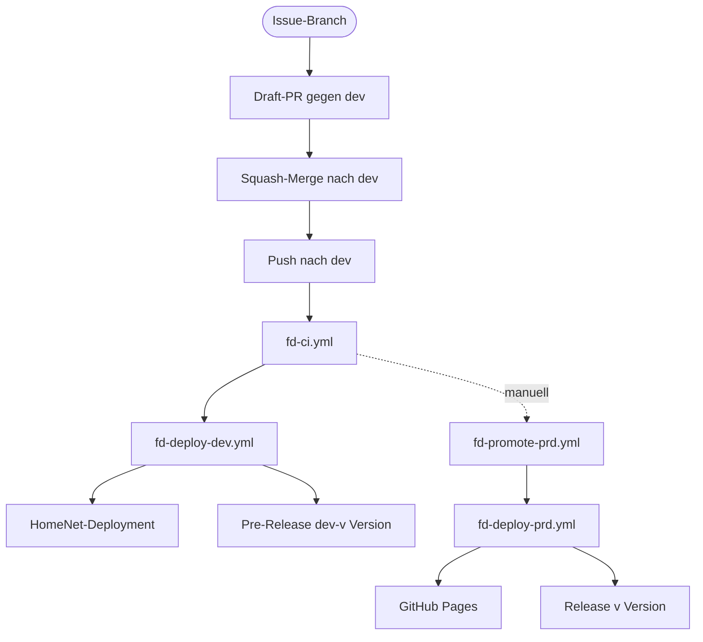

# FR006: Automatisierte Deployment-Workflows

Dieses Dokument beschreibt den aktuellen automatisierten Deployment-Ablauf des Repositories.

Die früher dokumentierten npm-Skripte `deploy:dev` und `deploy:prd` existieren nicht mehr. Die
Automatisierung läuft heute über GitHub Actions und eine Kette aus vier `fd-*`-Workflows.

## Übersicht

Es gibt zwei Deployment-Wege, die beide über `fd-ci` abgesichert sind:

- **`dev`-Deployment**: Ein Push auf `dev` startet
  [.github/workflows/fd-ci.yml](../../.github/workflows/fd-ci.yml). Ist dieser Lauf grün, stößt
  [.github/workflows/fd-deploy-dev.yml](../../.github/workflows/fd-deploy-dev.yml) das
  HomeNet-Deployment an und veröffentlicht das Pre-Release `dev-v<version>`.
- **Produktions-Deployment**: `main` wird ausschließlich über den Promote-Weg aktualisiert.
  [.github/workflows/fd-promote-prd.yml](../../.github/workflows/fd-promote-prd.yml) merged `dev`
  nach `main` und dispatcht
  [.github/workflows/fd-deploy-prd.yml](../../.github/workflows/fd-deploy-prd.yml), der GitHub Pages
  baut, deployt und anschließend Tag und Release setzt.

Direkte Pushes auf `main` und Pull Requests gegen `main` sind nicht vorgesehen. Für `main` gibt es
keinen lokalen Merge-Schritt mehr; die früher dokumentierte VS-Code-Task `Deploy to Main` und
`scripts/merge-branches.mjs` sind damit kein Bestandteil des Release-Ablaufs.

Vor dem Squash-Merge entscheidet der Release-Schalter am Pull Request, ob der PR die Version
anhebt. Jeder PR gegen `dev` trägt genau eines der Labels `release:yes` oder `release:no`; der
Required-Status-Check `check-release-label` prüft das Label und den Versionsvergleich. Regeln und
Einrichtung stehen in [Versionierung und
Release](../../workflow/versionierung%20und%20release.md).

## Architektur

Die Deployments sind bewusst aufgeteilt:

- `fd-ci.yml` prüft Lint, Format, Vale, einen 3D-Smoke-Test und die e2e-Tests.
- `fd-pr-release-label.yml` ist das Gate jedes Pull Requests gegen `dev`: Es prüft das
  Release-Label und den Versionsvergleich und meldet den Check `check-release-label`. Die
  Deploy-Workflows bleiben davon unberührt.
- `fd-deploy-dev.yml` startet nach einem erfolgreichen `fd-ci`-Lauf auf `dev` das
  HomeNet-Deployment (Tag `fd`) und publiziert das Pre-Release `dev-v<version>` genau für den
  Commit, den CI geprüft hat.
- `fd-promote-prd.yml` ist in Phase 1 manuell (`workflow_dispatch`) und prüft vor dem Merge die
  beiden `main`-Regeln: `package.json`-Version größer als das letzte stabile Release und eigener
  `## [x.y.z]`-Abschnitt in `CHANGELOG.md`. Zusätzlich muss die `dev`-Spitze einen grünen
  `fd-ci`-Lauf haben.
- `fd-deploy-prd.yml` ist der Produktionspfad: CI-Gate, Merge `dev` → `main`, Pages-Build und
  -Deploy, danach Tag und Release. Ein zweiter Lauf ohne neue Version ist ein No-Op.
- Die Validierung vor dem Push bleibt zusätzlich lokal: `npm run build` und `npm run lint:check`,
  optional `npm run prose`.

Die Runner sind bewusst unterschiedlich belegt: `fd-ci`, `fd-deploy-dev` und `fd-promote-prd`
laufen auf den self-hosted Runnern mit dem Label `fd`, `fd-deploy-prd` auf `ubuntu-latest`, weil
dort der Pages-Deploy mit `id-token` läuft.

Release-Modell:

- `dev`-Läufe erzeugen Pre-Releases `dev-v<version>`. Sie gelten nie als Produktionsstand und nie
  als Vergleichsbasis.
- Stabile Releases heißen `v<version>` und sind keine Pre-Releases. Der Promote vergleicht
  ausschließlich gegen das neueste stabile Release, damit ein Dev-Pre-Release die Produktion nicht
  blockieren kann.



## Voraussetzungen

Für beide Wege gilt:

- **Node.js**: >= 24.x
- **Git**: korrekt konfiguriert mit Benutzer-Credentials
- **Lokale Qualitätschecks** vor dem Push, mindestens `npm run build` und `npm run lint:check`
- **GitHub CLI (`gh`)** für Promote, Workflow-Runs und GitHub-Operationen

Zusätzlich für die Produktion:

- **Self-hosted Runner** mit dem Label `fd` für `fd-ci`, `fd-deploy-dev` und `fd-promote-prd`
- **Secret `HOMENET_PAT`** für das Dev-Deployment
- **Version und Changelog**: `version` in `package.json` höher als das letzte stabile Release und
  ein passender `## [x.y.z]`-Abschnitt in `CHANGELOG.md` — Einträge unter `## [Unreleased]` allein
  reichen für einen Promote nicht

## Dev-Deployment

1. Änderungen lokal prüfen und committen.
2. Auf `dev` pushen.
3. GitHub Actions startet [fd-ci.yml](../../.github/workflows/fd-ci.yml).
4. Nach grünem Lauf startet [fd-deploy-dev.yml](../../.github/workflows/fd-deploy-dev.yml), der das
   HomeNet-Repository mit dem Tag `fd` und der Source-Branch-Information dispatcht und das
   Pre-Release `dev-v<version>` anlegt.
5. Anschließend die Zielumgebung verifizieren.

Ein erneutes Dev-Deployment ohne neue Version ist kein Fehler: Das Pre-Release existiert bereits
und wird nicht verschoben.

## Produktions-Deployment

1. Sicherstellen, dass `dev` den gewünschten Stand enthält und `fd-ci` grün ist.
2. Version anheben: `npm run versionbump` schreibt `package.json`, `package-lock.json` und den
   `## [x.y.z]`-Abschnitt in `CHANGELOG.md`.
3. Den Versions-Commit auf `dev` pushen.
4. Promote auslösen:

   ```bash
   gh workflow run fd-promote-prd.yml
   ```

   Mit `dry_run` prüft der Workflow nur und ändert nichts:

   ```bash
   gh workflow run fd-promote-prd.yml -f dry_run=true
   ```

5. Der Workflow merged `dev` nach `main` und dispatcht
   [fd-deploy-prd.yml](../../.github/workflows/fd-deploy-prd.yml).
6. `fd-deploy-prd.yml` prüft die Version erneut, baut und veröffentlicht die Astro-Site über GitHub
   Pages und setzt erst danach Tag und Release `v<version>`.

Ein Promote auf einen unveränderten `dev`-Stand ist ein No-Op: `git merge` meldet
„Already up to date.“ und es wird nichts gepusht.

## Manuelle Eingriffe

- `gh workflow run fd-deploy-prd.yml` startet den Produktionspfad direkt. Das ist der Weg, um ein
  fehlgeschlagenes Deployment zu wiederholen, wenn keine neue Version nötig ist.
- `gh workflow run fd-deploy-dev.yml` wiederholt das Dev-Deployment und das Pre-Release für den
  aktuellen `dev`-Stand.
- `scripts/merge-branches.mjs` bleibt als lokales Werkzeug für Branch-Vergleiche verfügbar. Für
  `main` ist es nicht vorgesehen, weil es das Versions-Gate umgeht.

## Fehlerbehandlung

- Schlägt `fd-ci.yml` fehl, prüfe zuerst den Workflow-Run und die betroffene Stufe (Lint, Format,
  Vale, 3D-Smoke-Test, e2e).
- Schlägt `fd-deploy-dev.yml` fehl, prüfe den Run und das nachgelagerte HomeNet-Dispatch.
- Schlägt `fd-promote-prd.yml` fehl, prüfe die beiden `main`-Regeln: Ist die Version höher als das
  letzte stabile Release, und existiert der `## [x.y.z]`-Abschnitt in `CHANGELOG.md`?
- Schlägt `fd-deploy-prd.yml` nach dem Merge fehl, reicht ein erneuter Lauf des Workflows. Die
  Version bleibt unverändert, weil der Release erst nach einem erfolgreichen Pages-Deploy gesetzt
  wird.
- Vor jedem Produktions-Deployment sollten lokale Checks grün sein, damit Fehler nicht erst im
  Workflow auffallen.

## Siehe auch

- [Usage Guide](../11-dev-usage.md)
- [Branching- und Naming-Strategie](../13-dev-branch-naming-strategy.md)
- [Scripts Overview](../../scripts/README.md)
